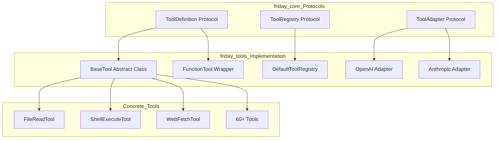
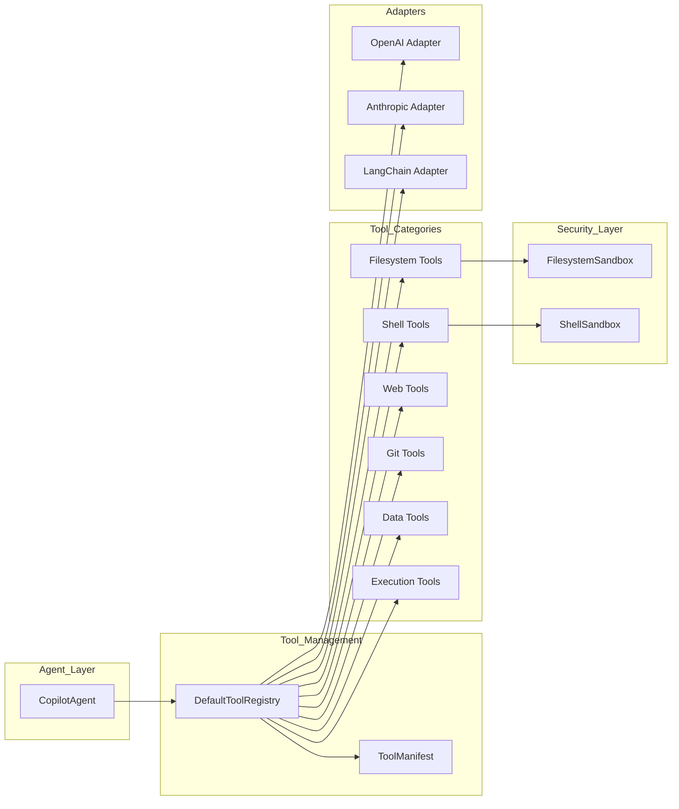
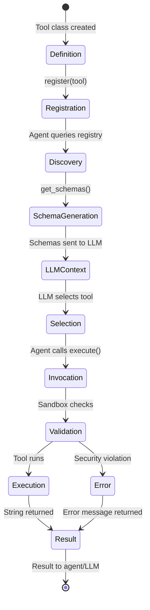
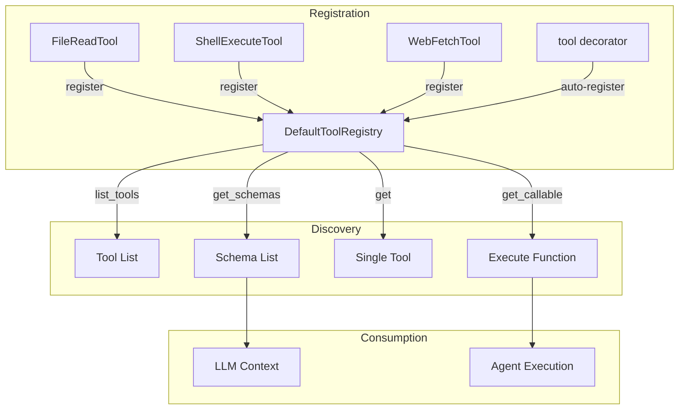
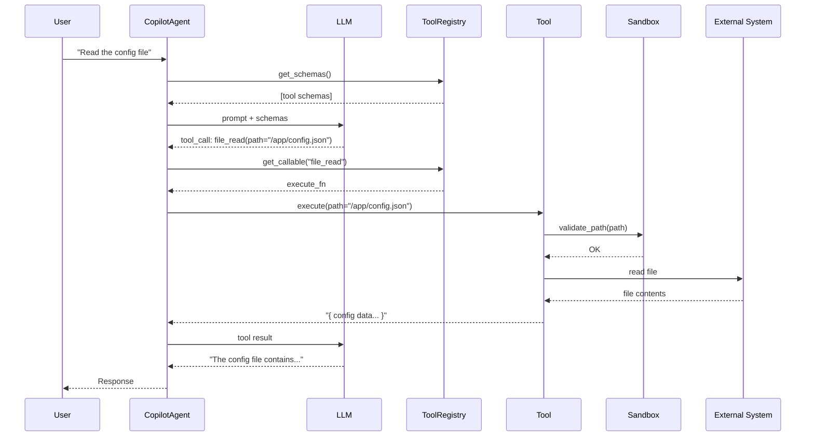
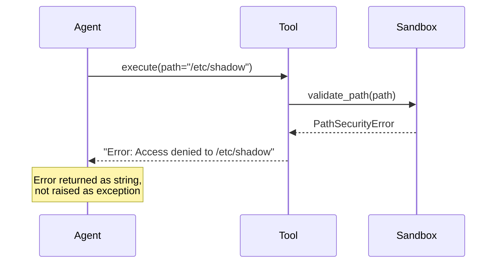
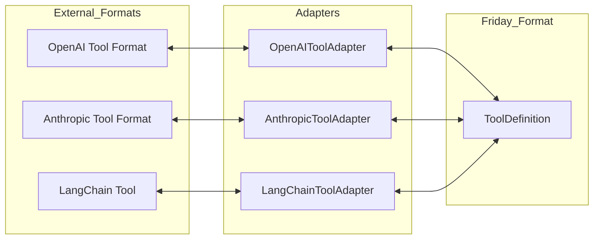
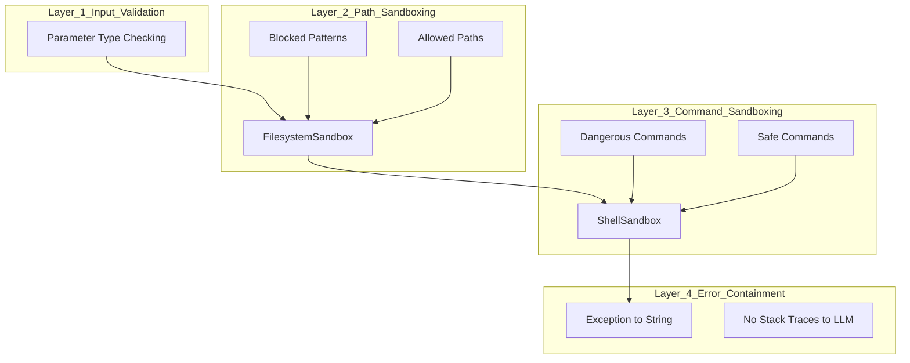

# Friday-Tools Package: Architecture & Design

> **Version:** 1.0
> **Package:** `friday-tools`
> **Location:** `packages/friday-tools/`

## Table of Contents

1. [Overview](#overview)
2. [Core Concepts](#core-concepts)
3. [Architecture](#architecture)
4. [Tool Lifecycle](#tool-lifecycle)
5. [Tool Discovery & Registration](#tool-discovery--registration)
6. [Tool Invocation Flow](#tool-invocation-flow)
7. [Creating Tools](#creating-tools)
8. [Framework Integration](#framework-integration)
9. [Security Model](#security-model)
10. [Package Structure](#package-structure)

---

## Overview

The `friday-tools` package provides a **protocol-driven tool system** for AI agents. It enables:

- **60+ production-ready tools** across filesystem, shell, web, git, data, and code categories
- **Async-first execution** for non-blocking agent operations
- **Schema-driven LLM integration** via JSON Schema and function calling formats
- **Framework adapters** for OpenAI, Anthropic, and LangChain
- **Layered security** with path and command sandboxing

### Design Principles

| Principle | Description |
|-----------|-------------|
| **Protocol-First** | All tools implement the `ToolDefinition` protocol from `friday-core` |
| **Async-First** | All tool execution is async (`async def execute`) |
| **Schema-Driven** | Tools generate JSON schemas for LLM function calling |
| **Sandbox-Aware** | Security validation is built into the tool layer |
| **Framework-Agnostic** | Adapters enable use with any LLM framework |

---

## Core Concepts

### What is a Tool?

A **tool** is a discrete capability that an AI agent can invoke. Each tool:

1. Has a **unique name** (e.g., `file_read`, `shell_execute`)
2. Provides a **description** for LLM understanding
3. Defines a **parameter schema** (JSON Schema format)
4. Implements an **async execute method** that performs the action

### The Protocol Stack



**Three protocols from `friday-core` define the contract:**

| Protocol | Purpose | Key Methods |
|----------|---------|-------------|
| `ToolDefinition` | Defines what a tool is | `name`, `description`, `parameters_schema`, `execute()`, `to_schema()` |
| `ToolRegistry` | Manages tool collections | `register()`, `get()`, `list_tools()`, `get_schemas()` |
| `ToolAdapter` | Converts external tools | `adapt()` - transforms foreign tool formats to Friday format |

---

## Architecture

### High-Level Component Diagram



### Key Components

| Component | Location | Responsibility |
|-----------|----------|----------------|
| `BaseTool` | `definition.py` | Abstract base class for all tools |
| `FunctionTool` | `definition.py` | Wraps Python functions as tools |
| `DefaultToolRegistry` | `registry.py` | Manages tool registration and lookup |
| `ToolManifest` | `manifest.py` | Generates tool documentation for LLMs |
| `FilesystemSandbox` | `sandbox.py` | Validates file path access |
| `ShellSandbox` | `sandbox.py` | Validates shell commands |
| Adapters | `adapters/` | Convert between framework formats |

---

## Tool Lifecycle

The lifecycle of a tool spans from definition through execution:



### Lifecycle Phases

#### 1. Definition Phase

A tool is defined by creating a class that inherits from `BaseTool` or using the `@tool` decorator:

```python
# Class-based definition
class FileReadTool(BaseTool):
    @property
    def name(self) -> str:
        return "file_read"

    @property
    def description(self) -> str:
        return "Read the contents of a file"

    @property
    def parameters_schema(self) -> dict:
        return {
            "type": "object",
            "properties": {
                "path": {"type": "string", "description": "File path to read"}
            },
            "required": ["path"]
        }

    async def execute(self, **kwargs) -> str:
        # Implementation
        pass
```

#### 2. Registration Phase

Tools are registered with a `ToolRegistry`:

```python
from friday_tools import DefaultToolRegistry

registry = DefaultToolRegistry()
registry.register(FileReadTool())
registry.register(ShellExecuteTool())
```

#### 3. Discovery Phase

The agent discovers available tools through the registry:

```python
# List all tool names
tool_names = registry.list_names()  # ["file_read", "shell_execute", ...]

# Get schemas for LLM
schemas = registry.get_schemas(format="openai")
```

#### 4. Schema Generation Phase

Schemas are formatted for LLM consumption:

```python
# Plain format
{
    "name": "file_read",
    "description": "Read the contents of a file",
    "parameters": {
        "type": "object",
        "properties": {...},
        "required": [...]
    }
}

# OpenAI function calling format
{
    "type": "function",
    "function": {
        "name": "file_read",
        "description": "Read the contents of a file",
        "parameters": {...}
    }
}
```

#### 5. Selection Phase

The LLM decides which tool to call based on user intent and available schemas.

#### 6. Invocation Phase

The agent invokes the selected tool:

```python
# Get the callable
tool_fn = registry.get_callable("file_read")

# Execute with LLM-provided arguments
result = await tool_fn(path="/home/user/document.txt")
```

#### 7. Validation Phase

Security sandboxes validate the operation:

```python
# FilesystemSandbox checks path access
sandbox.validate_path("/home/user/document.txt")  # OK
sandbox.validate_path("/etc/passwd")  # Raises PathSecurityError
```

#### 8. Execution Phase

The tool performs its operation asynchronously.

#### 9. Result Phase

Results are returned as strings (success or error):

```python
# Success
"File contents here..."

# Error (returned, not raised)
"Error: Permission denied: /etc/passwd"
```

---

## Tool Discovery & Registration

### The Registry Pattern



### Registration Methods

#### Method 1: Explicit Registration

```python
from friday_tools import DefaultToolRegistry
from friday_tools.filesystem import file_read, file_write

registry = DefaultToolRegistry()
registry.register(file_read)
registry.register(file_write)
```

#### Method 2: Using the @tool Decorator

```python
from friday_tools import tool, get_default_registry

@tool(name="my_tool", description="Does something useful")
async def my_tool(param: str) -> str:
    return f"Result: {param}"

# Automatically registered to default registry
registry = get_default_registry()
assert "my_tool" in registry
```

#### Method 3: Bulk Registration

```python
from friday_tools.filesystem import (
    file_read, file_write, file_delete,
    directory_list, directory_create
)

tools = [file_read, file_write, file_delete, directory_list, directory_create]
for tool in tools:
    registry.register(tool)
```

### Discovery Methods

| Method | Returns | Use Case |
|--------|---------|----------|
| `list_tools()` | `list[ToolDefinition]` | Get all tool instances |
| `list_names()` | `list[str]` | Get tool names for display |
| `get(name)` | `ToolDefinition \| None` | Get specific tool by name |
| `get_callable(name)` | `Callable` | Get execute function for invocation |
| `get_schemas(format)` | `list[dict]` | Get all schemas for LLM |
| `get_schema(name, format)` | `dict \| None` | Get specific tool schema |

---

## Tool Invocation Flow

### Complete Invocation Sequence



### Error Handling Flow



### Key Design Decision: Errors as Strings

Tools return errors as strings rather than raising exceptions. This allows:

1. **LLM reasoning** - The agent can pass errors back to the LLM for recovery
2. **Graceful degradation** - Failed tools don't crash the agent loop
3. **Consistent interface** - All tool outputs are strings

```python
async def execute(self, **kwargs) -> str:
    try:
        # ... operation
        return result
    except PermissionError as e:
        return f"Error: Permission denied: {e}"
    except FileNotFoundError as e:
        return f"Error: File not found: {e}"
```

---

## Creating Tools

### Method 1: BaseTool Subclass (Recommended for Complex Tools)

```python
from friday_tools import BaseTool
from friday_tools.sandbox import FilesystemSandbox

class MyFileTool(BaseTool):
    """A custom file processing tool."""

    def __init__(self, sandbox: FilesystemSandbox | None = None):
        self._sandbox = sandbox or FilesystemSandbox()

    @property
    def name(self) -> str:
        return "my_file_tool"

    @property
    def description(self) -> str:
        return "Process a file in a custom way"

    @property
    def parameters_schema(self) -> dict:
        return {
            "type": "object",
            "properties": {
                "path": {
                    "type": "string",
                    "description": "Path to the file to process"
                },
                "mode": {
                    "type": "string",
                    "enum": ["fast", "thorough"],
                    "description": "Processing mode",
                    "default": "fast"
                }
            },
            "required": ["path"]
        }

    async def execute(self, **kwargs) -> str:
        path = kwargs["path"]
        mode = kwargs.get("mode", "fast")

        try:
            # Validate path access
            validated_path = self._sandbox.validate_path(path)

            # Perform operation
            result = await self._process_file(validated_path, mode)
            return result

        except PathSecurityError as e:
            return f"Error: Access denied: {e}"
        except Exception as e:
            return f"Error: {type(e).__name__}: {e}"

    async def _process_file(self, path, mode):
        # Implementation details
        pass
```

### Method 2: FunctionTool Wrapper (Quick Prototyping)

```python
from friday_tools import FunctionTool

async def calculate_sum(numbers: list[int]) -> int:
    """Calculate the sum of a list of numbers.

    Args:
        numbers: List of integers to sum

    Returns:
        The sum of all numbers
    """
    return sum(numbers)

# Wrap as tool - schema auto-generated from type hints and docstring
sum_tool = FunctionTool(calculate_sum)

# Use it
result = await sum_tool.execute(numbers=[1, 2, 3, 4, 5])
# result: "15"
```

### Method 3: @tool Decorator (Simple Tools)

```python
from friday_tools import tool

@tool(name="greet", description="Generate a greeting message")
async def greet(name: str, formal: bool = False) -> str:
    if formal:
        return f"Good day, {name}. How may I assist you?"
    return f"Hey {name}!"

# Automatically registered to default registry
```

### Method 4: @create_tool Decorator (Explicit Schema)

```python
from friday_tools import create_tool

@create_tool(
    name="search_logs",
    description="Search application logs for a pattern",
    parameters_schema={
        "type": "object",
        "properties": {
            "pattern": {"type": "string"},
            "max_results": {"type": "integer", "default": 100}
        },
        "required": ["pattern"]
    }
)
async def search_logs(pattern: str, max_results: int = 100) -> str:
    # Implementation
    pass
```

### Schema Design Best Practices

1. **Clear descriptions** - LLMs use these to understand when to call the tool
2. **Explicit types** - Use JSON Schema types (`string`, `integer`, `boolean`, `array`, `object`)
3. **Required fields** - Mark truly required parameters
4. **Default values** - Provide sensible defaults where appropriate
5. **Enums for options** - Use `enum` for limited choice parameters

```python
{
    "type": "object",
    "properties": {
        "path": {
            "type": "string",
            "description": "Absolute or relative file path"
        },
        "encoding": {
            "type": "string",
            "enum": ["utf-8", "ascii", "latin-1"],
            "default": "utf-8",
            "description": "File encoding"
        },
        "max_lines": {
            "type": "integer",
            "minimum": 1,
            "maximum": 10000,
            "description": "Maximum lines to read (omit for all)"
        }
    },
    "required": ["path"]
}
```

---

## Framework Integration

### Adapter Architecture



### Using Adapters

#### OpenAI Integration

```python
from friday_tools.adapters import OpenAIToolAdapter

# Convert Friday tool to OpenAI format
openai_schema = OpenAIToolAdapter.to_openai_format(my_tool)
# {
#     "type": "function",
#     "function": {
#         "name": "my_tool",
#         "description": "...",
#         "parameters": {...}
#     }
# }

# Convert OpenAI tool to Friday format
adapter = OpenAIToolAdapter()
friday_tool = adapter.adapt(openai_tool_def, handler=my_handler_fn)
```

#### Anthropic Integration

```python
from friday_tools.adapters import AnthropicToolAdapter

# Convert Friday tool to Anthropic format
anthropic_schema = AnthropicToolAdapter.to_anthropic_format(my_tool)
# {
#     "name": "my_tool",
#     "description": "...",
#     "input_schema": {...}
# }

# Convert Anthropic tool to Friday format
adapter = AnthropicToolAdapter()
friday_tool = adapter.adapt(anthropic_tool_def, handler=my_handler_fn)
```

#### Bulk Schema Generation

```python
from friday_tools import DefaultToolRegistry

registry = DefaultToolRegistry()
# ... register tools ...

# Get all schemas in OpenAI format
openai_tools = registry.get_schemas(format="openai")

# Get all schemas in plain format
plain_tools = registry.get_schemas(format="plain")
```

---

## Security Model

### Defense in Depth



### FilesystemSandbox

Prevents access to sensitive system locations:

```python
from friday_tools.sandbox import FilesystemSandbox, PathSecurityError

sandbox = FilesystemSandbox()

# Default blocked patterns include:
# - /etc/, /var/, /usr/, /bin/, /sbin/
# - /root/, /proc/, /sys/, /dev/
# - ~/.ssh/, ~/.gnupg/, ~/.aws/, ~/.kube/
# - .env files, git credentials

# Validation
try:
    safe_path = sandbox.validate_path("/home/user/project/file.txt")
    # Returns resolved Path object
except PathSecurityError as e:
    print(f"Blocked: {e}")

# Custom allowed paths (whitelist mode)
sandbox = FilesystemSandbox(
    allowed_paths=["/home/user/workspace"],
    blocked_patterns=[]  # Override defaults if needed
)
```

### ShellSandbox

Prevents dangerous shell commands:

```python
from friday_tools.sandbox import ShellSandbox, CommandSecurityError

sandbox = ShellSandbox()

# Blocked patterns include:
# - rm -rf /, sudo, su
# - Direct file overwrites to system paths
# - Network attacks, fork bombs

try:
    sandbox.validate_command("ls -la /home/user")  # OK
    sandbox.validate_command("rm -rf /")  # Raises CommandSecurityError
except CommandSecurityError as e:
    print(f"Blocked: {e}")
```

### Configuring Security

```python
# Per-tool sandbox configuration
file_tool = FileReadTool(
    sandbox=FilesystemSandbox(
        allowed_paths=["/app/data", "/tmp"],
        blocked_patterns=[r".*\.secret$"]
    )
)

shell_tool = ShellExecuteTool(
    sandbox=ShellSandbox(
        allowed_commands=["ls", "cat", "grep", "find"],
        blocked_patterns=[]
    )
)
```

---

## Package Structure

```
packages/friday-tools/
├── pyproject.toml              # Package configuration
├── src/friday_tools/
│   ├── __init__.py             # Public exports
│   ├── definition.py           # BaseTool, FunctionTool
│   ├── registry.py             # DefaultToolRegistry, @tool decorator
│   ├── manifest.py             # ToolManifest for code generation
│   ├── protocols.py            # Re-exports from friday-core
│   ├── sandbox.py              # Security sandboxing
│   │
│   ├── adapters/               # Framework adapters
│   │   ├── __init__.py
│   │   ├── openai.py           # OpenAI function calling
│   │   ├── anthropic.py        # Anthropic tools
│   │   └── langchain.py        # LangChain integration
│   │
│   ├── filesystem/             # File operations (17 tools)
│   │   ├── __init__.py
│   │   ├── read.py             # file_read, file_read_lines, file_info, file_grep
│   │   ├── write.py            # file_write, file_append, file_insert, file_replace
│   │   ├── operations.py       # file_move, file_copy, file_delete, file_chmod
│   │   └── directory.py        # directory_list, directory_tree, directory_create
│   │
│   ├── shell/                  # Shell execution (2+ tools)
│   │   ├── __init__.py
│   │   ├── execute.py          # shell_execute, shell_script
│   │   └── system.py           # System info tools
│   │
│   ├── web/                    # Web operations (4+ tools)
│   │   ├── __init__.py
│   │   ├── fetch.py            # web_fetch, web_extract_links, web_extract_text
│   │   └── search.py           # Web search tools
│   │
│   ├── git/                    # Git operations (4+ tools)
│   │   ├── __init__.py
│   │   ├── status.py           # git_status, git_diff, git_log, git_show
│   │   └── branches.py         # Branch management
│   │
│   ├── data/                   # Data format tools (10+ tools)
│   │   ├── __init__.py
│   │   ├── json_tools.py       # json_read, json_query, json_write
│   │   ├── yaml_tools.py
│   │   ├── csv_tools.py
│   │   └── toml_tools.py
│   │
│   ├── text/                   # Text processing (3+ tools)
│   │   ├── __init__.py
│   │   ├── search.py           # text_search, text_extract
│   │   └── transform.py        # text_transform
│   │
│   ├── code/                   # Code analysis (2+ tools)
│   │   ├── __init__.py
│   │   ├── analyze.py          # code_analyze
│   │   └── format.py           # code_format
│   │
│   ├── execution/              # Python execution (2 tools)
│   │   ├── __init__.py
│   │   ├── python.py           # python_execute (sandboxed)
│   │   └── unsandboxed.py      # python_execute_unsandboxed
│   │
│   └── codegen/                # Code generation meta-tool
│       ├── __init__.py
│       ├── tool.py             # CodeGenerationTool
│       └── prompts.py          # LLM prompts
│
└── tests/
    └── test_protocols.py       # Protocol compliance tests
```

### Tool Categories Summary

| Category | Tools | Primary Use |
|----------|-------|-------------|
| `filesystem/` | 17 | File and directory operations |
| `shell/` | 2+ | Command execution |
| `web/` | 4+ | HTTP requests, scraping |
| `git/` | 4+ | Version control |
| `data/` | 10+ | JSON, YAML, CSV, TOML, XML |
| `text/` | 3+ | Search, transform |
| `code/` | 2+ | Analysis, formatting |
| `execution/` | 2 | Python code execution |
| `codegen/` | 1 | LLM-based tool composition |

---

## Appendix: Quick Reference

### Importing Tools

```python
# Individual tools
from friday_tools.filesystem import file_read, file_write

# Registry and decorators
from friday_tools import DefaultToolRegistry, tool, get_default_registry

# Base classes for custom tools
from friday_tools import BaseTool, FunctionTool

# Security
from friday_tools import FilesystemSandbox, ShellSandbox

# Adapters
from friday_tools.adapters import OpenAIToolAdapter, AnthropicToolAdapter
```

### Common Patterns

```python
# Pattern 1: Create registry with specific tools
registry = DefaultToolRegistry()
registry.register(file_read)
registry.register(shell_execute)
schemas = registry.get_schemas(format="openai")

# Pattern 2: Execute tool from registry
tool_fn = registry.get_callable("file_read")
result = await tool_fn(path="/app/config.json")

# Pattern 3: Custom tool with sandbox
class MyTool(BaseTool):
    def __init__(self, sandbox=None):
        self._sandbox = sandbox or FilesystemSandbox()
    # ... implement abstract methods

# Pattern 4: Function-based tool
@tool(name="quick_tool", description="A quick prototype")
async def quick_tool(x: str) -> str:
    return x.upper()
```

---

## Version History

| Version | Date | Changes |
|---------|------|---------|
| 1.0 | 2025-01-07 | Initial design document |
