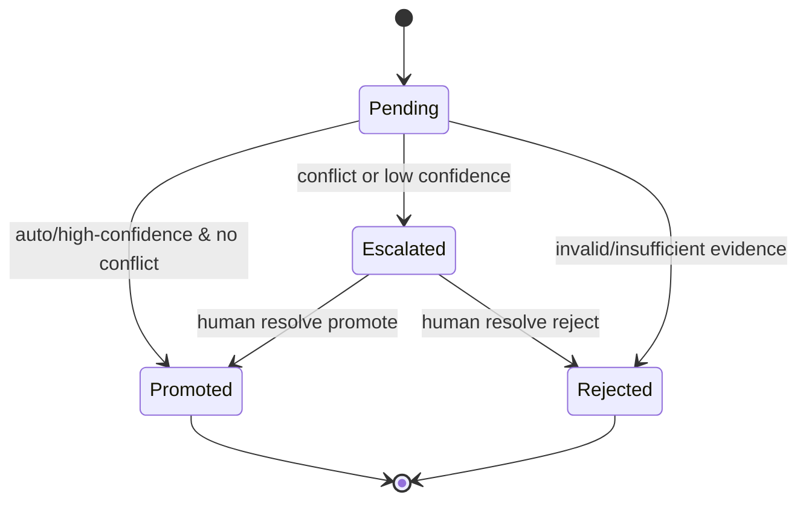
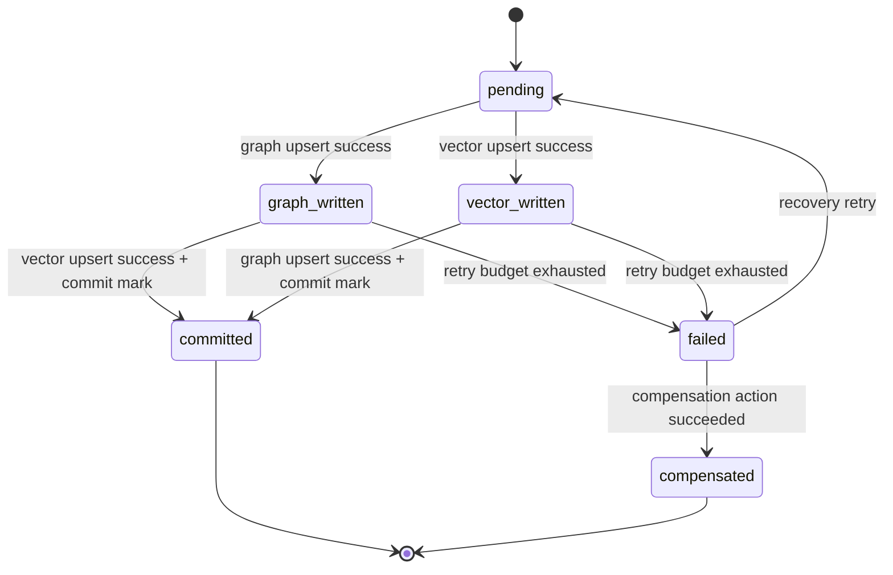
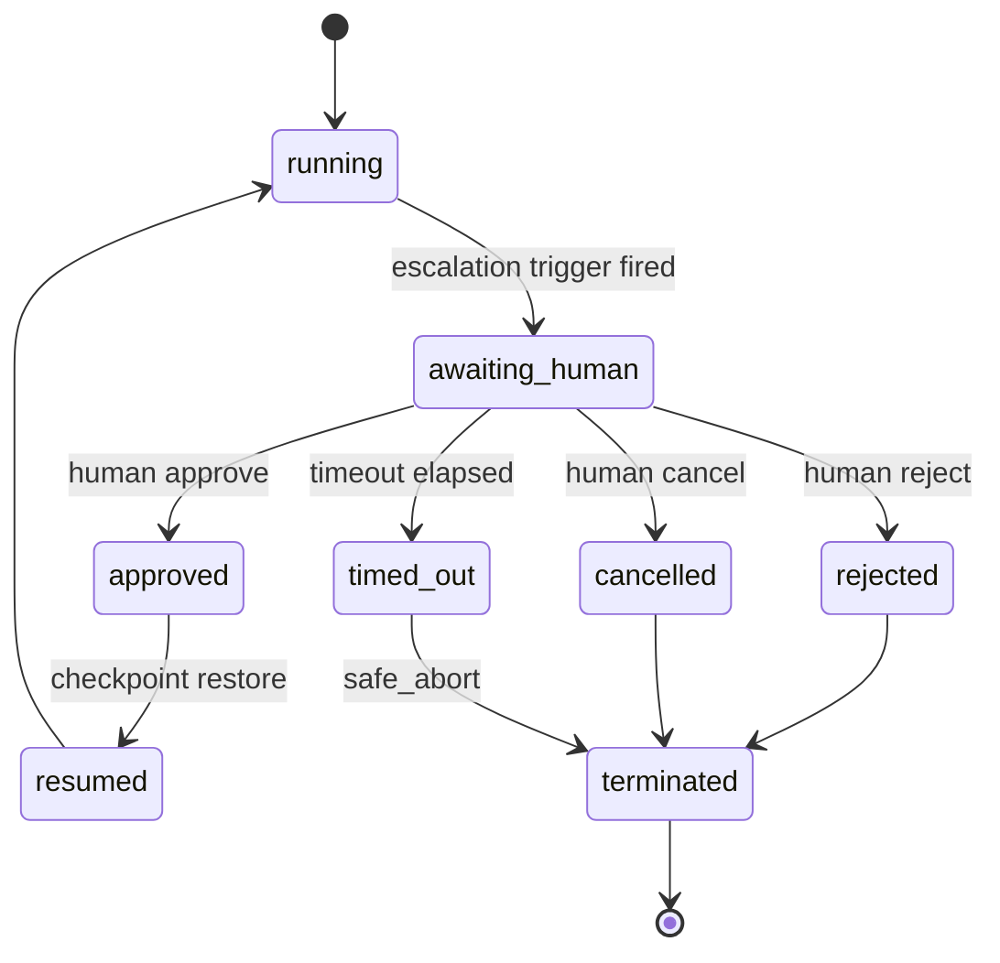
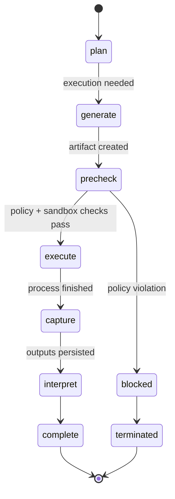

# Friday Agent Framework: Technical Specifications (Alt Phase 2)

**Status:** Proposed for Approval (Alternative Architecture)
**Date:** 2026-02-14
**Scope:** Additive Multi-Agent Memory design while preserving existing single-agent contracts
**Supersedes For Alt Path:** `docs/design/agents/Phase-2/technical-specifications.md`
**Governed By:**
- `docs/design/agents/Alt-Phase-2/agent-contract.md`
- `docs/design/agents/Alt-Phase-2/agent-contract-compliance-matrix.md`
- `docs/design/agents/Alt-Phase-2/agent-contract-schema-spec.md`
- `docs/design/agents/Alt-Phase-2/agent-contract-test-strategy.md`

---

## 1. Compatibility Contract

## 1.1 Non-Breaking Rule

Alt Phase 2 SHALL NOT require breaking changes to existing Phase 1 public interfaces:

1. `AgentInterface.initialize_session(session_id: str | None = None, user_id: str = "default")`
2. `SystemRuntime.spawn_agent(name: str)`
3. `SystemRuntime.create_session(user_id: str = "default")`

## 1.2 Additive Extension Rule

All multi-agent capabilities are introduced via additive interfaces, services, and runtime configuration.

---

## 2. Runtime Modes

## 2.1 Memory Mode Enumeration

```python
class MemoryMode(str, Enum):
    SINGLE_AGENT = "single_agent"
    MULTI_AGENT = "multi_agent"
```

### Behavioral Contract

1. `SINGLE_AGENT`:
   - Existing `MemoryController` semantics.
   - No namespace requirement.
   - Default mode for compatibility.
2. `MULTI_AGENT`:
   - Namespace-aware reads/writes.
   - Arbitrator-controlled shared-memory promotion.
   - Proposal journal and recovery semantics enabled.

---

## 3. Interface Contracts (Additive)

## 3.1 MultiAgentMemoryInterface

```python
class MultiAgentMemoryInterface(ABC):
    @abstractmethod
    async def write_private_fact(self, namespace: str, node: GraphNode, edge: GraphEdge | None = None) -> bool:
        ...

    @abstractmethod
    async def write_private_insight(
        self,
        namespace: str,
        text: str,
        provenance: ProvenanceMetadata,
        extra_metadata: dict[str, Any] | None = None,
    ) -> bool:
        ...

    @abstractmethod
    async def recall_union(
        self,
        namespace: str,
        query: str,
        session_id: str | None = None,
        token_limit: int = 2000,
    ) -> ContextPayload:
        ...

    @abstractmethod
    async def submit_proposal(self, proposal: "MemoryProposal") -> "ArbitrationTicket":
        ...
```

### Notes

1. This interface composes existing memory retrieval/write primitives.
2. It does not replace `MemoryController` in `SINGLE_AGENT` mode.

---

## 3.2 ArbitrationInterface

```python
class ArbitrationInterface(ABC):
    @abstractmethod
    async def submit_proposal(self, proposal: "MemoryProposal") -> "ArbitrationResult":
        ...

    @abstractmethod
    async def get_decision(self, ticket_id: str) -> "ArbitrationResult":
        ...

    @abstractmethod
    async def resolve_conflict(
        self,
        ticket_id: str,
        decision: Literal["promoted", "rejected"],
        reason: str,
        resolver_id: str,
    ) -> "ArbitrationResult":
        ...
```

### Required Semantics

1. Arbitrator is sole authority for writes to `shared:/` in `MULTI_AGENT` mode.
2. Conflict resolution supports both automated and human override workflows.

---

## 3.3 NamespacePolicyInterface

```python
class NamespacePolicyInterface(ABC):
    @abstractmethod
    def validate_namespace(self, namespace: str) -> None:
        ...

    @abstractmethod
    def can_read(self, caller_id: str, target_namespace: str) -> bool:
        ...

    @abstractmethod
    def can_write(self, caller_id: str, target_namespace: str) -> bool:
        ...

    @abstractmethod
    def build_union_read_scope(self, active_namespace: str) -> list[str]:
        ...
```

### Required Enforcement Points

1. Facade level (`MultiAgentMemoryController`).
2. Collection/vector write entry points.
3. Graph write entry points.
4. Promotion coordinator commit path.

---

## 3.4 AgentContractValidationInterface

```python
class AgentContractValidationInterface(ABC):
    @abstractmethod
    def validate_contract(self, contract: "AgentContract") -> None:
        ...

    @abstractmethod
    def validate_for_mode(
        self,
        contract: "AgentContract",
        memory_mode: MemoryMode,
    ) -> None:
        ...
```

### Required Semantics

1. Agent registration/loading MUST fail fast when mandatory contract fields are missing.
2. Mode-specific checks MUST enforce additional policy requirements where applicable.
3. Validation errors MUST be structured and actionable for operator remediation.

---

## 4. Data Schemas

## 4.1 Namespace Schema

```python
class NamespaceId(BaseModel):
    raw: str

    # canonical private namespace
    # ^(?P<agent>[a-z][a-z0-9_]*)-(?P<token>[a-f0-9]{8}):/$
```

### Reserved Values

1. `shared:/`
2. `arbitrator:/`

---

## 4.2 MemoryProposal

```python
class MemoryProposal(BaseModel):
    proposal_id: str
    source_agent_id: str
    source_namespace: str
    session_id: str

    entity_name: str
    attribute: str
    value: str

    confidence: float = Field(ge=0.0, le=1.0)
    evidence: list[str] = Field(default_factory=list)

    # graph/vector payload references for promotion
    graph_node_id: str | None = None
    graph_edge_fingerprint: str | None = None
    vector_doc_ids: list[str] = Field(default_factory=list)

    created_at: datetime
```

---

## 4.3 ArbitrationResult

```python
class ArbitrationResult(BaseModel):
    proposal_id: str
    ticket_id: str
    status: Literal["promoted", "rejected", "escalated", "pending"]

    reason: str | None = None
    reviewer_id: str | None = None

    promotion_id: str | None = None
    created_at: datetime
    updated_at: datetime
```

---

## 4.4 Promotion Journal Schema

```python
class PromotionJournalRecord(BaseModel):
    promotion_id: str
    proposal_id: str

    status: Literal[
        "pending",
        "graph_written",
        "vector_written",
        "committed",
        "compensated",
        "failed",
    ]

    graph_write_id: str | None = None
    vector_write_id: str | None = None

    retry_count: int = 0
    last_error: str | None = None

    created_at: datetime
    updated_at: datetime
```

### Invariant

Records are only visible as shared truth when `status == "committed"`.

---

## 4.5 Metadata Extensions

### Multi-Agent Mode Metadata Requirements

Vector metadata and graph properties SHALL include:

1. `namespace`
2. `author_id`
3. `proposal_id` (when promoted)
4. `promotion_id` (when promoted)

### Single-Agent Mode Compatibility

1. Existing data without namespace remains valid.
2. Namespace fields are optional in baseline models.

---

## 4.6 Agent Contract Schemas

```python
class ModelPolicy(BaseModel):
    primary_model: str
    fallback_models: list[str] = Field(default_factory=list)
    max_cost_per_task_usd: float | None = None
    max_latency_ms: int | None = None


class ToolPolicy(BaseModel):
    allowed_tools: list[str]
    denied_tools: list[str] = Field(default_factory=list)
    approval_required_tools: list[str] = Field(default_factory=list)
    max_tool_calls_per_task: int | None = None
    max_tool_time_seconds: int | None = None


class SandboxPolicy(BaseModel):
    required: bool = True
    writable_roots: list[str]
    network_mode: Literal["none", "restricted", "full"] = "restricted"
    command_allowlist: list[str] = Field(default_factory=list)
    timeout_seconds: int = 120
    cpu_limit: float | None = None
    memory_limit_mb: int | None = None
    privileged_exec_requires_hitl: bool = True


class HITLAuthorityPolicy(BaseModel):
    allowed_roles: list[str]
    decision_scope: dict[str, list[str]] = Field(default_factory=dict)
    delegated_approvers: list[str] = Field(default_factory=list)
    conflict_of_interest_rules: list[str] = Field(default_factory=list)


class HITLPolicy(BaseModel):
    enabled: bool = True
    methods: list[Literal[
        "approval_gate",
        "decision_selection",
        "clarification_loop",
        "conflict_adjudication",
        "override_interrupt",
        "checkpoint_review",
    ]]
    timeout_seconds: int = 900
    default_action_on_timeout: Literal["safe_abort", "defer", "constrained_continue"] = "safe_abort"
    max_reminders: int = 2
    authority_policy: HITLAuthorityPolicy


class GuardrailPolicy(BaseModel):
    scope_rules: list[str] = Field(default_factory=list)
    safety_rules: list[str] = Field(default_factory=list)
    data_rules: list[str] = Field(default_factory=list)
    execution_rules: list[str] = Field(default_factory=list)
    authority_rules: list[str] = Field(default_factory=list)


class EscalationPolicy(BaseModel):
    trigger_classes: list[str]
    mandatory_approval_actions: list[str] = Field(default_factory=list)
    default_escalation_method: Literal[
        "approval_gate",
        "decision_selection",
        "clarification_loop",
        "conflict_adjudication",
    ] = "approval_gate"


class ArtifactPolicy(BaseModel):
    lifecycle_states: list[Literal["draft", "validated", "final", "archived"]]
    publication_requires_approval: bool = False
    required_provenance_fields: list[str] = Field(default_factory=list)


class LoggingPolicy(BaseModel):
    structured: bool = True
    required_events: list[str]
    correlation_id_required: bool = True
    log_completeness_threshold: float = 1.0


class FailurePolicy(BaseModel):
    max_retries: int = 3
    backoff_strategy: Literal["fixed", "exponential"] = "exponential"
    rollback_on_terminal: bool = True
    compensation_required_for_side_effects: bool = True


class AgentContract(BaseModel):
    agent_id: str
    name: str
    role: str
    backstory: str

    goals: list[str]
    objectives: list[str]
    success_criteria: list[str]
    stop_conditions: list[str]

    mode: Literal["autonomous", "semi_autonomous", "copilot"]
    memory_mode: MemoryMode

    workspace_roots: list[str]
    model_policy: ModelPolicy
    tool_policy: ToolPolicy
    sandbox_policy: SandboxPolicy
    hitl_policy: HITLPolicy
    guardrail_policy: GuardrailPolicy
    escalation_policy: EscalationPolicy
    artifact_policy: ArtifactPolicy
    logging_policy: LoggingPolicy
    failure_policy: FailurePolicy
```

### Contract Validation Invariants

1. `tool_policy.allowed_tools` MUST be non-empty for non-trivial agents.
2. `sandbox_policy.required` MUST be true for agents executing generated code.
3. `hitl_policy.enabled` MUST be true for `semi_autonomous` and `copilot` modes.
4. `hitl_policy.authority_policy.allowed_roles` MUST be non-empty when HITL is enabled.
5. `artifact_policy.lifecycle_states` MUST include `draft` and `final`.
6. `guardrail_policy` MUST define at least one rule in each category when the agent executes tools.
7. `escalation_policy.trigger_classes` MUST include low-confidence, policy-ambiguity, and high-impact side-effect triggers.

---

## 5. State Machines

## 5.1 Arbitration Lifecycle



---

## 5.2 Promotion Journal Lifecycle



### Atomicity Guarantee

1. A promotion is externally visible as shared truth only in `committed`.
2. Recovery worker replays non-terminal records after restart.

---

## 5.3 Workflow Integration Lifecycle (Phase 2 Compatible)

No new `WorkflowState` type is required in Alt Phase 2.

1. Use existing `TaskStatus.WAITING_APPROVAL` when arbitration escalates to human decision.
2. Map arbitration escalation events to existing workflow pause semantics.

---

## 5.4 HITL Decision Lifecycle



### Required Runtime Semantics

1. Entering `awaiting_human` MUST pause side-effecting tool calls.
2. Privileged sandbox execution MUST remain blocked until `approved`.
3. Decision payload MUST carry `request_id`, options, recommendation, deadline, and default action.
4. Timeout behavior MUST be deterministic and auditable.

---

## 5.5 Code Execution Lifecycle



### Required Runtime Semantics

1. Execution MUST not enter `execute` until tool policy and sandbox policy checks pass.
2. `capture` MUST persist stdout/stderr references, exit status, artifact identifiers, and run metadata.
3. `interpret` MUST bind execution claims to captured outputs before agent response finalization.
4. Blocked or failed runs MUST route through `FailurePolicy` and produce structured failure events.

---

## 5.6 Multi-Agent Delegation/Handoff Contract

Required handoff payload fields:

1. `handoff_id`
2. `from_agent_id`
3. `to_agent_id`
4. `task_id` and `session_id`
5. `delegated_objective`
6. `acceptance_criteria`
7. `input_artifact_ids`
8. `memory_scope` (`private`, `shared`, `mixed`)
9. `deadline` and fallback action
10. provenance metadata (`created_at`, `created_by`, `correlation_id`)

Handoff invariants:

1. Handoff payload MUST be immutable after acceptance except for explicit revision events.
2. Ownership boundaries MUST be explicit and auditable per delegated objective.
3. Acceptance criteria MUST be machine-checkable where feasible for deterministic verification.

---

## 6. Namespace Policy Specification

## 6.1 Format

1. Private: `^(?P<agent>[a-z][a-z0-9_]*)-(?P<token>[a-f0-9]{8}):/$`
2. Shared: `shared:/`
3. Arbitrator internal: `arbitrator:/`

## 6.2 Access Rules (Multi-Agent Mode)

1. Private write: allowed only for owner identity.
2. Private read: allowed for owner identity (future allow-list optional).
3. Shared write: allowed only for arbitrator identity.
4. Shared read: allowed to all authenticated agent identities in multi-agent session.
5. Union read default scope: `[active_private_namespace, "shared:/"]`.

## 6.3 Single-Agent Mode Rule

Namespace policy is not mandatory in single-agent mode.

---

## 6.4 HITL Authority Rules

1. Approval decisions MUST be validated against `HITLAuthorityPolicy`.
2. Unauthorized approvals MUST be rejected and logged as policy violations.
3. Decision scope MUST be explicit per action class (for example, destructive ops vs publication).
4. Delegated approvers MUST be auditable with identity and timestamp metadata.

---

## 6.5 Escalation Trigger Taxonomy

Escalation trigger classes MUST include:

1. `low_confidence_critical_decision`
2. `policy_ambiguity`
3. `high_impact_side_effect`
4. `repeated_failure_threshold`
5. `conflicting_evidence`
6. `user_mandated_checkpoint`

Each trigger class MUST map to:

1. required HITL method,
2. timeout/default behavior profile,
3. approver authority scope.

---

## 7. Error Handling Strategy

## 7.1 Error Types

1. `NamespaceAccessError`
2. `NamespaceValidationError`
3. `ArbitrationServiceUnavailableError`
4. `PromotionCommitError`
5. `PromotionRecoveryError`

## 7.2 Mandatory Fallback Behaviors

1. If arbitrator is unavailable in multi-agent mode:
   - shared promotions are blocked,
   - private writes remain allowed,
   - system remains operational with degraded shared convergence.
2. If promotion commit fails:
   - record journal state with error,
   - retries proceed via recovery worker,
   - shared visibility remains withheld until committed.

---

## 7.3 Generalized Failure Domains

1. **Tool Failures:** command errors, policy denials, timeout/limit breaches.
2. **Sandbox Failures:** resource limit exhaustion, prohibited command, escape attempt.
3. **HITL Failures:** timeout, unauthorized approver, unresolved escalation.
4. **Artifact Failures:** invalid lifecycle transition or missing required provenance.

### Required Behavior

1. Failure handling MUST route through contract-defined `FailurePolicy`.
2. Terminal failures with side effects MUST trigger rollback or compensation workflows.
3. Every terminal failure MUST include structured remediation guidance.

---

## 7.4 Execution Result Integrity Requirements

1. Agents MUST not assert execution outcomes that are absent from observed runtime outputs.
2. Every code-execution result record MUST include:
   - command or entrypoint,
   - sandbox profile identifier,
   - exit code,
   - stdout/stderr capture references,
   - produced artifact IDs and hashes where available.
3. Execution claims in agent responses SHOULD be traceable to recorded run metadata.
4. Integrity violations MUST be emitted as structured policy events and counted in KPI reporting.

---

## 8. Testing Requirements

## 8.1 Backward Compatibility Tests

1. Existing single-agent tests run unchanged under default mode.
2. `friday.py` integration flow remains operational without namespace arguments.

## 8.2 Multi-Agent Security Tests

1. Non-arbitrator shared write rejection.
2. Cross-agent private read denial.
3. Union read visibility of committed shared facts.

## 8.3 Atomicity & Recovery Tests

1. Crash between graph and vector writes produces recoverable non-committed record.
2. Startup recovery converges incomplete promotions to terminal state.
3. Idempotent replay of same proposal does not duplicate shared truth.

## 8.4 Bypass Resistance Tests

Validate no shared-write bypass through:

1. extractor flows,
2. ingestion flows,
3. lifecycle/promotion/maintenance subroutines,
4. direct collection manager usage in multi-agent mode.

---

## 8.5 Contract Compliance Tests

1. Agent contract schema validation tests (missing/invalid field behavior).
2. Tool policy enforcement tests (allowlist/denylist/approval requirements).
3. Sandbox policy enforcement tests (writable roots, network mode, timeout behavior).
4. HITL protocol tests (payload schema, authority checks, timeout/default action).
5. Logging completeness tests for required event sets.
6. Artifact lifecycle/provenance policy tests.
7. Generalized failure-policy behavior tests across tool/sandbox/HITL domains.
8. Execution-result integrity tests (claim-to-output traceability and metadata completeness).

---

## 8.6 Checklist-to-CI Evidence Mapping

Every contract checklist item MUST map to a CI evidence artifact:

1. Contract field completeness -> `contract-validation-report.json`
2. Guardrail/runtime enforcement -> `policy-enforcement-report.json`
3. Tool/sandbox gating -> `execution-governance-report.json`
4. HITL semantics and authority -> `hitl-protocol-report.json`
5. Logging/event completeness -> `observability-completeness-report.json`
6. Failure/recovery coverage -> `failure-policy-report.json`
7. Workspace/artifact boundaries -> `artifact-workspace-compliance-report.json`
8. Memory mode/provenance behavior -> `memory-compatibility-migration-report.json`

Release candidates MUST publish this artifact set as part of verification gates.

---

## 9. Runtime Configuration

## 9.1 Required Additive Config

```yaml
memory:
  mode: single_agent  # single_agent | multi_agent
  contracts:
    validate_on_agent_load: true
    fail_on_missing_required_fields: true
  execution:
    sandbox_required_default: true
    privileged_exec_requires_hitl: true
  telemetry:
    enforce_required_events: true
    required_event_schema_version: "1.0"
    kpi_targets:
      hitl_median_response_latency_seconds: 300
      hitl_timeout_rate_ceiling: 0.05
      required_event_completeness_threshold: 0.99
    checklist_artifacts_required: true
  multi_agent:
    enabled: false
    namespace:
      token_length: 8
      private_pattern: "<agent>-<token>:/"
    arbitrator:
      auto_promote_confidence: 0.90
      conflict_escalation_confidence: 0.70
    promotion:
      recovery_on_startup: true
      retry_limit: 5
```

### Compatibility Defaults

1. Default remains `single_agent`.
2. `friday.py` behavior unchanged until explicit enablement.

---

## 10. Phase 3 Technical Handshake

Alt Phase 2 must leave the following clean handoff points for Phase 3:

1. Orchestrator-level namespace context propagation (without breaking existing APIs).
2. Route decomposition into explicit `route()` stage while preserving process/delegate behavior.
3. Workflow approvals driven by arbitration escalations using existing task status model.
4. Observability hooks for proposal lifecycle and promotion recovery metrics.
5. HITL protocol payload/state/authority semantics formalized and integrated.
6. Tool/sandbox governance policies enforced in runtime execution flows.

---

## 11. Metadata Migration and Backfill Strategy

1. Multi-agent metadata rollout MUST include migration strategy for legacy records missing `namespace` and promotion fields.
2. Migration MUST support reversible rollout and explicit rollback criteria.
3. Validation metrics MUST track query correctness across mixed migrated/unmigrated datasets.
4. Backfill operations MUST emit structured migration events for auditability.
