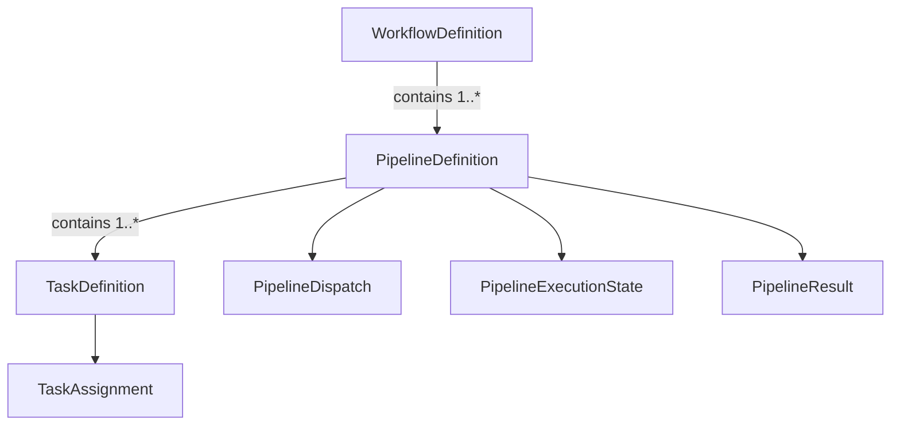
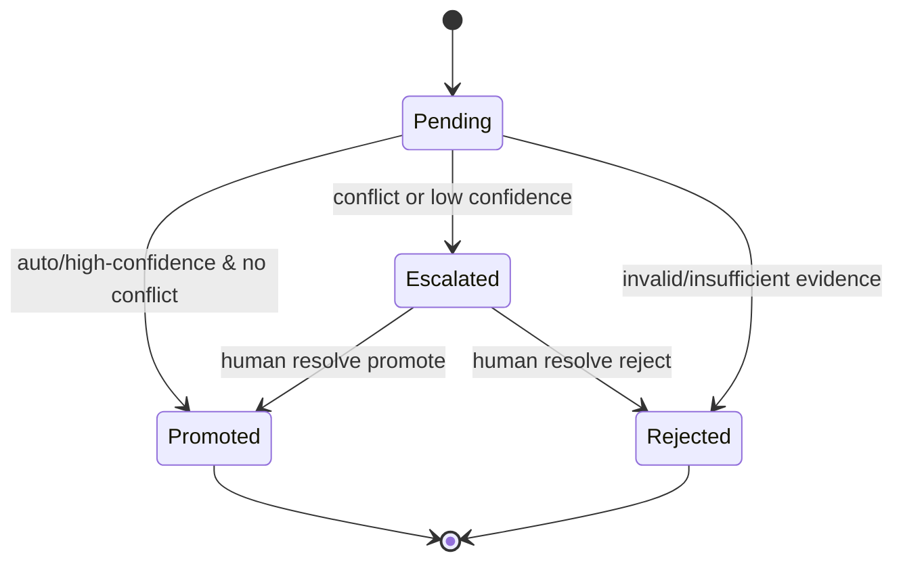
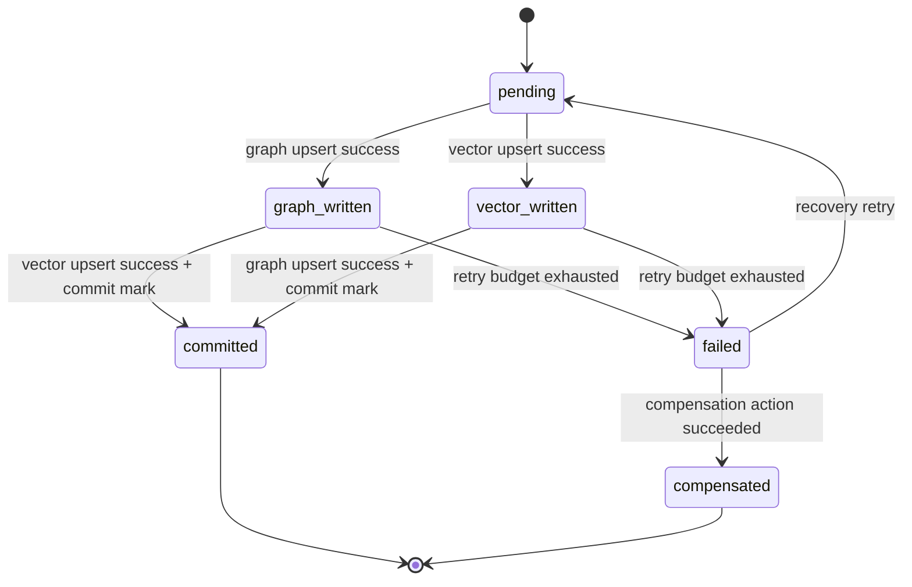
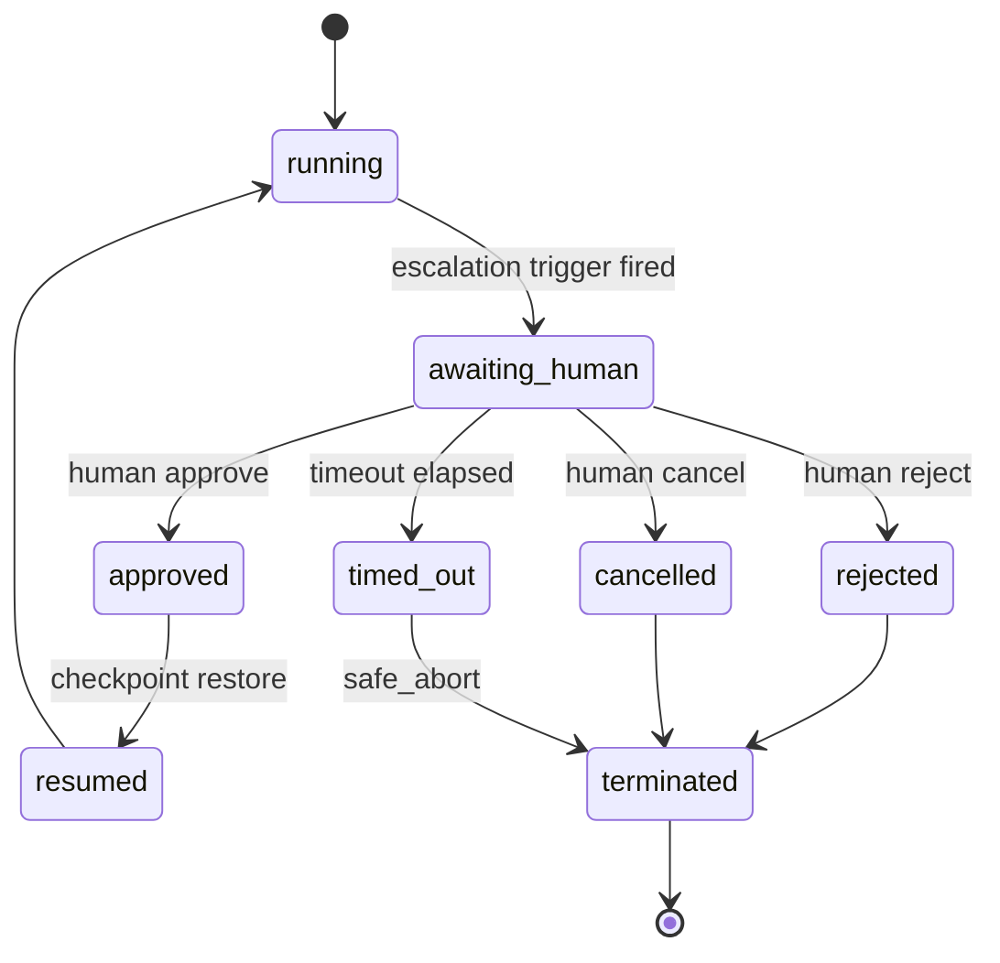
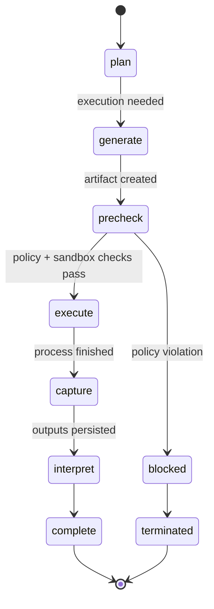
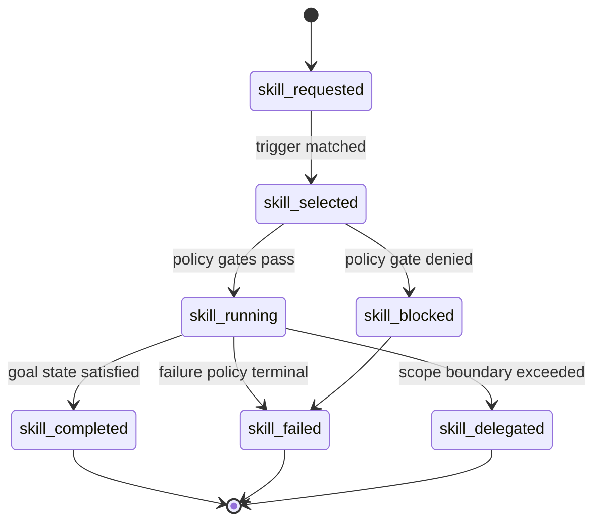
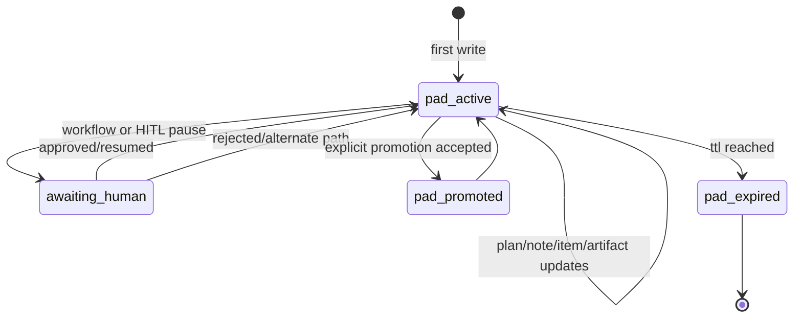
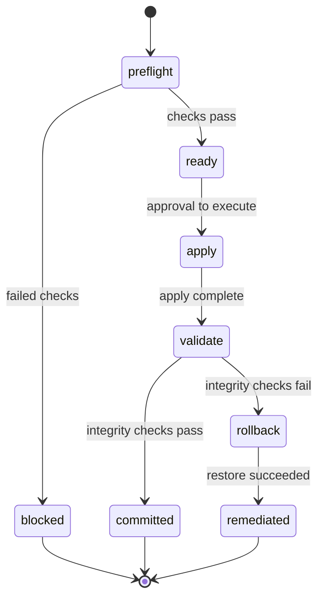
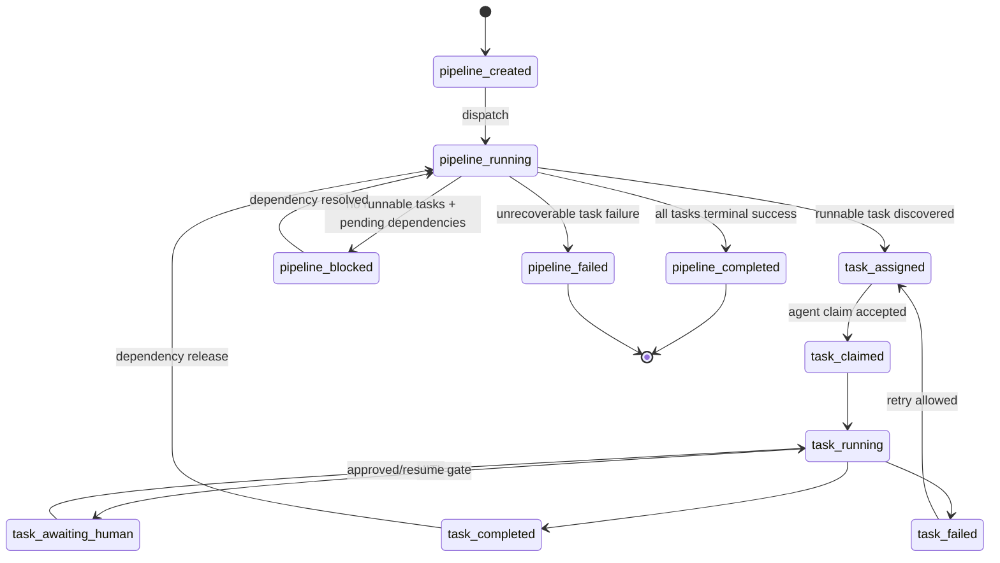

# Friday Agent Framework: Technical Specifications (Alt Phase 2)

**Status:** Proposed for Approval (Alternative Architecture)
**Date:** 2026-02-14
**Scope:** Additive Multi-Agent Memory design while preserving existing single-agent contracts
**Supersedes For Alt Path:** `docs/design/agents/Phase-2/technical-specifications.md`
**Governed By:**
- `docs/design/agents/Alt-Phase-2/agent-contract.md`
- `docs/design/agents/Alt-Phase-2/agent-contract-compliance-matrix.md`
- `docs/design/agents/Alt-Phase-2/agent-contract-schema-spec.md`
- `docs/design/agents/Alt-Phase-2/agent-contract-test-strategy.md`

---

## 1. Compatibility Contract

## 1.1 Non-Breaking Rule

Alt Phase 2 SHALL NOT require breaking changes to existing Phase 1 public interfaces:

1. `AgentInterface.initialize_session(session_id: str | None = None, user_id: str = "default")`
2. `SystemRuntime.spawn_agent(name: str)`
3. `SystemRuntime.create_session(user_id: str = "default")`

## 1.2 Additive Extension Rule

All multi-agent capabilities are introduced via additive interfaces, services, and runtime configuration.

---

## 2. Runtime Modes

## 2.1 Memory Mode Enumeration

```python
class MemoryMode(str, Enum):
    SINGLE_AGENT = "single_agent"
    MULTI_AGENT = "multi_agent"
```

### Behavioral Contract

1. `SINGLE_AGENT`:
   - Existing `MemoryController` semantics.
   - No namespace requirement.
   - Default mode for compatibility.
2. `MULTI_AGENT`:
   - Namespace-aware reads/writes.
   - Arbitrator-controlled shared-memory promotion.
   - Proposal journal and recovery semantics enabled.

## 2.2 Runtime Filesystem Topology

All deployments (local install, container, cloud VM/service) MUST be configured using a git-agnostic filesystem model.

Required roots:

1. `install_root`:
   - Code/package installation location.
   - May be read-only in production-like runtimes.
2. `runtime_data_root`:
   - Writable runtime state root.
   - Hosts memory-state internals, journals, scratch-pad storage, and runtime indexes.
3. `workspace_root`:
   - Writable task workspace for agent-created artifacts/intermediates.
   - MUST NOT host internal runtime-state stores.

Optional root:

1. `cache_root`:
   - Rebuildable cache data only.
   - Loss of cache MUST NOT violate correctness.

Placement rules:

1. Scratch-pad persisted storage MUST be under `runtime_data_root`.
2. Scratch-pad persisted storage MUST NOT be under `workspace_root` except explicit test-mode fixtures.
3. Runtime startup MUST fail fast on invalid root/path overlap that violates these constraints.

---

## 3. Interface Contracts (Additive)

## 3.1 MultiAgentMemoryInterface

```python
class MultiAgentMemoryInterface(ABC):
    @abstractmethod
    async def write_private_fact(self, namespace: str, node: GraphNode, edge: GraphEdge | None = None) -> bool:
        ...

    @abstractmethod
    async def write_private_insight(
        self,
        namespace: str,
        text: str,
        provenance: ProvenanceMetadata,
        extra_metadata: dict[str, Any] | None = None,
    ) -> bool:
        ...

    @abstractmethod
    async def recall_union(
        self,
        namespace: str,
        query: str,
        session_id: str | None = None,
        token_limit: int = 2000,
    ) -> ContextPayload:
        ...

    @abstractmethod
    async def submit_proposal(self, proposal: "MemoryProposal") -> "ArbitrationTicket":
        ...
```

### Notes

1. This interface composes existing memory retrieval/write primitives.
2. It does not replace `MemoryController` in `SINGLE_AGENT` mode.

---

## 3.2 ArbitrationInterface

```python
class ArbitrationInterface(ABC):
    @abstractmethod
    async def submit_proposal(self, proposal: "MemoryProposal") -> "ArbitrationResult":
        ...

    @abstractmethod
    async def get_decision(self, ticket_id: str) -> "ArbitrationResult":
        ...

    @abstractmethod
    async def resolve_conflict(
        self,
        ticket_id: str,
        decision: Literal["promoted", "rejected"],
        reason: str,
        resolver_id: str,
    ) -> "ArbitrationResult":
        ...
```

### Required Semantics

1. Arbitrator is sole authority for writes to `shared:/` in `MULTI_AGENT` mode.
2. Conflict resolution supports both automated and human override workflows.

---

## 3.3 NamespacePolicyInterface

```python
class NamespacePolicyInterface(ABC):
    @abstractmethod
    def validate_namespace(self, namespace: str) -> None:
        ...

    @abstractmethod
    def can_read(self, caller_id: str, target_namespace: str) -> bool:
        ...

    @abstractmethod
    def can_write(self, caller_id: str, target_namespace: str) -> bool:
        ...

    @abstractmethod
    def build_union_read_scope(self, active_namespace: str) -> list[str]:
        ...
```

### Required Enforcement Points

1. Facade level (`MultiAgentMemoryController`).
2. Collection/vector write entry points.
3. Graph write entry points.
4. Promotion coordinator commit path.

---

## 3.4 AgentContractValidationInterface

```python
class AgentContractValidationInterface(ABC):
    @abstractmethod
    def validate_contract(self, contract: "AgentContract") -> None:
        ...

    @abstractmethod
    def validate_for_mode(
        self,
        contract: "AgentContract",
        memory_mode: MemoryMode,
    ) -> None:
        ...
```

### Required Semantics

1. Agent registration/loading MUST fail fast when mandatory contract fields are missing.
2. Mode-specific checks MUST enforce additional policy requirements where applicable.
3. Validation errors MUST be structured and actionable for operator remediation.
4. If `skills` are declared, validation MUST enforce pinned `SkillRef` format and manifest resolution rules.

---

## 3.5 Skill Manifest Repository Interfaces

```python
class SkillManifestRepositoryInterface(ABC):
    @abstractmethod
    def load_manifest(self, skill_id: str, version: str) -> "SkillManifest":
        ...

    @abstractmethod
    def list_versions(self, skill_id: str) -> list[str]:
        ...


class SkillRegistryInterface(ABC):
    @abstractmethod
    def resolve(self, skill_ref: str) -> "SkillRegistryEntry":
        ...

    @abstractmethod
    def status(self, skill_ref: str) -> Literal["proposed", "approved", "deprecated", "retired"]:
        ...


class SkillResolverInterface(ABC):
    @abstractmethod
    def resolve_for_agent(self, contract: "AgentContract", skill_ref: str) -> "SkillManifest":
        ...
```

### Required Semantics

1. Skill manifests are loaded from local filesystem-backed manifest storage in Alt Phase 2.
2. `skill_ref` format MUST be `skill_id@major.minor.patch`.
3. Production-like execution MUST reject skills not in `approved` state.
4. Resolution MUST fail fast for unknown skill IDs, unknown versions, or policy-incompatible tool chains.

---

## 3.6 ScratchPadMemoryInterface

```python
class ScratchPadMemoryInterface(ABC):
    @abstractmethod
    async def create_or_get_pad(self, session_id: str, agent_id: str) -> "ScratchPadHandle":
        ...

    @abstractmethod
    async def upsert_plan(self, session_id: str, agent_id: str, plan_id: str, title: str, objective: str) -> bool:
        ...

    @abstractmethod
    async def add_plan_item(
        self,
        session_id: str,
        agent_id: str,
        plan_id: str,
        item_id: str,
        text: str,
        status: Literal["pending", "running", "completed", "blocked"] = "pending",
    ) -> bool:
        ...

    @abstractmethod
    async def update_plan_item_status(
        self,
        session_id: str,
        agent_id: str,
        item_id: str,
        status: Literal["pending", "running", "completed", "blocked"],
    ) -> bool:
        ...

    @abstractmethod
    async def add_note(self, session_id: str, agent_id: str, text: str) -> str:
        ...

    @abstractmethod
    async def add_artifact_ref(
        self,
        session_id: str,
        agent_id: str,
        artifact_path: str,
        artifact_id: str | None = None,
    ) -> bool:
        ...

    @abstractmethod
    async def list_entries(self, session_id: str, agent_id: str, limit: int = 200) -> list["ScratchPadEntry"]:
        ...

    @abstractmethod
    async def purge_expired(self) -> int:
        ...

    @abstractmethod
    async def promote_entries(
        self,
        session_id: str,
        agent_id: str,
        entry_ids: list[str],
        target: Literal["insight", "fact", "summary"],
    ) -> bool:
        ...
```

### Required Semantics

1. Scratch pad scope key MUST be `(session_id, agent_id)`.
2. Scratch pad access is private to owner identity by default.
3. Scratch pad data is operational memory and MUST NOT be included in semantic recall by default.
4. Scratch-to-durable promotion MUST be explicit and policy-gated.
5. Scratch backend MUST be runtime-configurable (`in_memory` or `sqlite`).
6. When backend is persistent (`sqlite`), storage path MUST resolve under `runtime_data_root`.
7. Scratch storage path MUST NOT resolve under `workspace_root` except explicit test-mode fixtures.

---

## 3.7 Internal Identity and Capability Interfaces

```python
class InternalIdentityProviderInterface(ABC):
    @abstractmethod
    def current_identity(self) -> "InternalIdentityContext":
        ...


class ArbitratorCapabilityServiceInterface(ABC):
    @abstractmethod
    def issue_shared_write_capability(
        self,
        session_id: str,
        run_id: str,
        ttl_seconds: int = 300,
    ) -> str:
        ...

    @abstractmethod
    def validate_shared_write_capability(
        self,
        capability_token: str,
        session_id: str,
        run_id: str,
    ) -> bool:
        ...
```

### Required Semantics

1. Shared writes to `shared:/` MUST require both:
   - identity class `arbitrator`,
   - valid runtime-issued shared-write capability.
2. Arbitrator identity string without capability MUST be rejected.
3. Capability tokens MUST be scope-bound (`session_id`, `run_id`) and time-bound.
4. Capability replay outside declared scope MUST be rejected and logged.
5. Capability validation MUST be enforced at facade and storage-boundary shared-write entrypoints.

---

## 4. Data Schemas

## 4.1 Namespace Schema

```python
class NamespaceId(BaseModel):
    raw: str

    # canonical private namespace
    # ^(?P<agent>[a-z][a-z0-9_]*)-(?P<token>[a-f0-9]{8}):/$
```

### Reserved Values

1. `shared:/`
2. `arbitrator:/`

---

## 4.2 MemoryProposal

```python
class MemoryProposal(BaseModel):
    proposal_id: str
    source_agent_id: str
    source_namespace: str
    session_id: str

    entity_name: str
    attribute: str
    value: str

    confidence: float = Field(ge=0.0, le=1.0)
    evidence: list[str] = Field(default_factory=list)

    # graph/vector payload references for promotion
    graph_node_id: str | None = None
    graph_edge_fingerprint: str | None = None
    vector_doc_ids: list[str] = Field(default_factory=list)

    created_at: datetime
```

---

## 4.3 ArbitrationResult

```python
class ArbitrationResult(BaseModel):
    proposal_id: str
    ticket_id: str
    status: Literal["promoted", "rejected", "escalated", "pending"]

    reason: str | None = None
    reviewer_id: str | None = None

    promotion_id: str | None = None
    created_at: datetime
    updated_at: datetime
```

---

## 4.4 Promotion Journal Schema

```python
class PromotionJournalRecord(BaseModel):
    promotion_id: str
    proposal_id: str

    status: Literal[
        "pending",
        "graph_written",
        "vector_written",
        "committed",
        "compensated",
        "failed",
    ]

    graph_write_id: str | None = None
    vector_write_id: str | None = None

    retry_count: int = 0
    last_error: str | None = None

    created_at: datetime
    updated_at: datetime
```

### Invariant

Records are only visible as shared truth when `status == "committed"`.

---

## 4.5 Metadata Extensions

### Multi-Agent Mode Metadata Requirements

Vector metadata and graph properties SHALL include:

1. `namespace`
2. `author_id`
3. `proposal_id` (when promoted)
4. `promotion_id` (when promoted)

### Single-Agent Mode Compatibility

1. Existing data without namespace remains valid.
2. Namespace fields are optional in baseline models.

---

## 4.6 Agent Contract Schemas

```python
class ModelPolicy(BaseModel):
    primary_model: str
    fallback_models: list[str] = Field(default_factory=list)
    max_cost_per_task_usd: float | None = None
    max_latency_ms: int | None = None


class ToolPolicy(BaseModel):
    allowed_tools: list[str]
    denied_tools: list[str] = Field(default_factory=list)
    approval_required_tools: list[str] = Field(default_factory=list)
    max_tool_calls_per_task: int | None = None
    max_tool_time_seconds: int | None = None


class SandboxPolicy(BaseModel):
    required: bool = True
    writable_roots: list[str]
    network_mode: Literal["none", "restricted", "full"] = "restricted"
    command_allowlist: list[str] = Field(default_factory=list)
    timeout_seconds: int = 120
    cpu_limit: float | None = None
    memory_limit_mb: int | None = None
    privileged_exec_requires_hitl: bool = True


class HITLAuthorityPolicy(BaseModel):
    allowed_roles: list[str]
    decision_scope: dict[str, list[str]] = Field(default_factory=dict)
    delegated_approvers: list[str] = Field(default_factory=list)
    conflict_of_interest_rules: list[str] = Field(default_factory=list)


class HITLPolicy(BaseModel):
    enabled: bool = True
    methods: list[Literal[
        "approval_gate",
        "decision_selection",
        "clarification_loop",
        "conflict_adjudication",
        "override_interrupt",
        "checkpoint_review",
    ]]
    timeout_seconds: int = 900
    default_action_on_timeout: Literal["safe_abort", "defer", "constrained_continue"] = "safe_abort"
    max_reminders: int = 2
    authority_policy: HITLAuthorityPolicy


class GuardrailPolicy(BaseModel):
    scope_rules: list[str] = Field(default_factory=list)
    safety_rules: list[str] = Field(default_factory=list)
    data_rules: list[str] = Field(default_factory=list)
    execution_rules: list[str] = Field(default_factory=list)
    authority_rules: list[str] = Field(default_factory=list)


class EscalationPolicy(BaseModel):
    trigger_classes: list[str]
    mandatory_approval_actions: list[str] = Field(default_factory=list)
    default_escalation_method: Literal[
        "approval_gate",
        "decision_selection",
        "clarification_loop",
        "conflict_adjudication",
    ] = "approval_gate"


class SkillManifest(BaseModel):
    skill_id: str
    version: str
    status: Literal["proposed", "approved", "deprecated", "retired"]
    owner: str
    description: str
    triggers: list[str]
    goal_state: list[str]
    tool_chain: list[str]
    context_requirements: list[str] = Field(default_factory=list)
    invariants: list[str] = Field(default_factory=list)
    outputs: list[str] = Field(default_factory=list)
    scope_boundary: dict[str, list[str]] = Field(default_factory=dict)
    handoff_policy: dict[str, str] = Field(default_factory=dict)
    sandbox_requirements: dict[str, Any] = Field(default_factory=dict)
    hitl_requirements: dict[str, Any] = Field(default_factory=dict)
    provenance_requirements: dict[str, Any] = Field(default_factory=dict)
    kpi_targets: dict[str, float] = Field(default_factory=dict)


class SkillRegistryEntry(BaseModel):
    skill_ref: str  # "<skill_id>@<version>"
    manifest_path: str
    status: Literal["proposed", "approved", "deprecated", "retired"]
    owner: str
    review_metadata: dict[str, Any] = Field(default_factory=dict)


class ScratchPadPolicy(BaseModel):
    enabled: bool = False
    retention_ttl_seconds: int = 86400
    max_entries: int = 500
    max_note_bytes: int = 8192
    allow_promotion: bool = True


class ScratchPadEntry(BaseModel):
    entry_id: str
    entry_type: Literal["plan", "plan_item", "note", "artifact_ref", "event_log"]
    session_id: str
    agent_id: str
    created_at: datetime
    payload: dict[str, Any]


class ArtifactPolicy(BaseModel):
    lifecycle_states: list[Literal["draft", "validated", "final", "archived"]]
    publication_requires_approval: bool = False
    required_provenance_fields: list[str] = Field(default_factory=list)


class LoggingPolicy(BaseModel):
    structured: bool = True
    required_events: list[str]
    correlation_id_required: bool = True
    log_completeness_threshold: float = 1.0


class FailurePolicy(BaseModel):
    max_retries: int = 3
    backoff_strategy: Literal["fixed", "exponential"] = "exponential"
    rollback_on_terminal: bool = True
    compensation_required_for_side_effects: bool = True


class AgentContract(BaseModel):
    agent_id: str
    name: str
    role: str
    backstory: str

    goals: list[str]
    objectives: list[str]
    success_criteria: list[str]
    stop_conditions: list[str]

    mode: Literal["autonomous", "semi_autonomous", "copilot"]
    memory_mode: MemoryMode

    workspace_roots: list[str]
    model_policy: ModelPolicy
    tool_policy: ToolPolicy
    sandbox_policy: SandboxPolicy
    hitl_policy: HITLPolicy
    guardrail_policy: GuardrailPolicy
    escalation_policy: EscalationPolicy
    artifact_policy: ArtifactPolicy
    logging_policy: LoggingPolicy
    failure_policy: FailurePolicy
    skills: list[str] = Field(default_factory=list)  # list of SkillRef values: "<skill_id>@<semver>"
    scratch_pad_policy: ScratchPadPolicy | None = None
```

### Contract Validation Invariants

1. `tool_policy.allowed_tools` MUST be non-empty for non-trivial agents.
2. `sandbox_policy.required` MUST be true for agents executing generated code.
3. `hitl_policy.enabled` MUST be true for `semi_autonomous` and `copilot` modes.
4. `hitl_policy.authority_policy.allowed_roles` MUST be non-empty when HITL is enabled.
5. `artifact_policy.lifecycle_states` MUST include `draft` and `final`.
6. `guardrail_policy` MUST define at least one rule in each category when the agent executes tools.
7. `escalation_policy.trigger_classes` MUST include low-confidence, policy-ambiguity, and high-impact side-effect triggers.
8. If `skills` are declared, each entry MUST match `skill_id@major.minor.patch`.
9. If `skills` are declared, each entry MUST resolve to an existing `SkillManifest` in the registry.
10. Only `approved` skill versions may execute in production-like environments.
11. Every resolved `SkillManifest.tool_chain` entry MUST be included in `tool_policy.allowed_tools`.
12. Skills that produce artifacts MUST satisfy workspace and artifact policy constraints.
13. Privileged skill steps MUST honor HITL approval requirements when configured.
14. If `scratch_pad_policy.enabled` is true, `retention_ttl_seconds`, `max_entries`, and `max_note_bytes` MUST be positive.
15. Scratch pad entries MUST preserve owner scope (`session_id`, `agent_id`) for every write.
16. Scratch pad promotion MUST be blocked when `scratch_pad_policy.allow_promotion` is false.

---

## 4.7 Skill Manifest Repository and Registry

Alt Phase 2 canonical local layout:

1. Portable canonical skill artifact: `skills/<skill_id>/<version>/SKILL.md`
2. Governance manifest overlay: `skills/manifests/<skill_id>/<version>.yaml`
3. Registry index: `skills/registry/index.yaml`

`SKILL.md` requirements:

1. MUST include valid YAML frontmatter for machine-readable metadata.
2. MUST map deterministically to `SkillManifest` and `SkillRegistryEntry` fields.
3. MUST be validated with the AgentSkills reference validator (`skills-ref validate`) before approval and before production-like execution.
4. MUST include sections sufficient to derive:
   - profile layer (backstory/runtime-instruction behavior),
   - task layer (tooling/task flow behavior),
   - artifact expectations (output/artifact intent and provenance expectations).

Reference source for compatibility baseline:

1. AgentSkills reference repository: `https://github.com/agentskills/agentskills/tree/main`.
2. Additional ecosystem reference: `https://github.com/anthropics/skills`.

Registry index minimum fields:

1. `skill_ref` (`<skill_id>@<version>`)
2. `manifest_path`
3. `status` (`proposed`, `approved`, `deprecated`, `retired`)
4. `owner`
5. `review_metadata`

Approval metadata requirement:

1. For `status == approved`, `review_metadata` MUST include:
   - `approval_id`,
   - `approved_by`,
   - `approved_at`,
   - `change_reason`.

Resolution flow:

1. Parse `SkillRef` from `AgentContract.skills`.
2. Resolve `SkillRegistryEntry` from index.
3. Load canonical `SKILL.md` and validate frontmatter/schema via `skills-ref validate`.
4. Load `SkillManifest` governance overlay and validate `SKILL.md -> manifest` field mapping.
5. Enforce lifecycle-state policy for current environment.
6. Enforce tool/policy compatibility against agent contract.
7. Compute contract-to-skill policy diff and classify impact (`content_only`, `behavioral`, `governance_touching`).
8. Enforce approval policy for impact class.
9. Execute with trace events that include resolved `skill_ref`.

Runtime composition semantics:

1. Baseline runtime envelope is loaded from `AgentContract`.
2. Skill profile/task/artifact sections are applied as runtime overlays.
3. Governance policies use restrictive merge:
   - effective policy = intersection/most restrictive result.
4. Any attempted expansion beyond contract hard limits MUST fail activation.
5. Skill overlay replacement is allowed for soft fields (for example, `backstory`) when approval gates for the impact class are satisfied.

Approval gating requirements for canonical `SKILL.md`:

1. `content_only`: standard approval workflow.
2. `behavioral`: requires policy-diff evidence and governance approval.
3. `governance_touching`: requires dual approval (`governance` + `security/safety`) and mandatory behavior-test evidence.

Mandatory CI checks for skill-enabled agents:

1. Frontmatter/schema validity for every `SKILL.md`.
2. Directory/layout and naming-convention validity for canonical skill paths.
3. Deterministic mapping validity from `SKILL.md` metadata to internal registry/manifest fields.
4. Policy-diff and impact-class classifier determinism for every skill change.
5. No-expansion assertion checks (tool/sandbox/HITL/workspace envelope cannot widen).

Governance evidence requirements:

1. `skills-ref validate` output MUST be retained in release evidence artifacts.
2. CI conformance reports for schema/layout/mapping checks MUST be retained in release evidence artifacts.
3. Policy-diff and impact-classification reports MUST be retained in release evidence artifacts.
4. Governance-touching skill approvals MUST include dual-approval metadata and behavior-test reports.

Mandatory failure modes:

1. `SKILL_REF_INVALID`: reference format invalid.
2. `SKILL_NOT_FOUND`: skill or version missing from registry.
3. `SKILL_STATUS_DISALLOWED`: lifecycle state blocked for execution.
4. `SKILL_POLICY_CONFLICT`: manifest tool chain conflicts with agent/tool/sandbox/HITL policy.
5. `SKILL_APPROVAL_METADATA_MISSING`: transition/execution attempted without required approval metadata for approved state.
6. `SKILL_SCHEMA_INVALID`: canonical `SKILL.md` failed reference-schema validation.
7. `SKILL_LAYOUT_INVALID`: canonical skill directory/name/layout violates repository conventions.
8. `SKILL_MAPPING_INVALID`: canonical `SKILL.md` metadata does not map consistently to governance overlay fields.
9. `SKILL_POLICY_EXPANSION_DENIED`: skill overlay attempts to widen contract governance envelope.
10. `SKILL_APPROVAL_CLASS_MISMATCH`: skill impact class requires a stronger approval path than provided.
11. `SKILL_BEHAVIOR_EVIDENCE_MISSING`: required behavior-test evidence missing for impact class.

---

## 4.8 Scratch Pad Storage and Lifecycle

Canonical identity:

1. `session_id`
2. `agent_id`

Storage backends:

1. `in_memory`:
   - Ephemeral, process-lifetime store.
   - Recommended for fast local/dev or short-lived sessions.
2. `sqlite`:
   - Local lightweight persistent store.
   - Recommended for production-like/HITL-heavy sessions requiring restart continuity.
   - Scratch DB path MUST be under `runtime_data_root`.

Typed entry expectations:

1. `plan`: high-level objective and status.
2. `plan_item`: checklist/task item with mutable status.
3. `note`: operational rationale or short-lived observations.
4. `artifact_ref`: workspace artifact pointer and optional hash/id metadata.
5. `event_log`: append-only mutation/audit event.

Lifecycle and retention:

1. Scratch pads are lazily created on first write.
2. Scratch pads are TTL-governed operational state.
3. Expired pads MUST be purged and emit `scratchpad_expired` events.
4. Scratch entries are promotable only through explicit policy-allowed operations.
5. Purge cadence MUST be runtime-configurable (`purge_interval_seconds`) for persistent backends.
6. Runtime fallback behavior on scratch backend failure MUST be explicit (`fail_fast` or `disable_scratch`).

Mandatory failure modes:

1. `SCRATCHPAD_SCOPE_VIOLATION`: caller attempts access outside `(session_id, agent_id)` scope.
2. `SCRATCHPAD_TTL_EXPIRED`: operation targets an expired scratch pad.
3. `SCRATCHPAD_QUOTA_EXCEEDED`: entry or note exceeds configured limits.
4. `SCRATCHPAD_PROMOTION_BLOCKED`: promotion attempted when policy disallows promotion.
5. `SCRATCHPAD_INVALID_PATH`: configured scratch path violates root-placement rules.
6. `SCRATCHPAD_BACKEND_UNAVAILABLE`: configured backend initialization or I/O failure.

---

## 4.9 Internal Identity and Capability Schemas

```python
class InternalIdentityContext(BaseModel):
    caller_id: str
    identity_class: Literal["agent", "arbitrator", "system"]
    session_id: str | None = None
    run_id: str | None = None


class SharedWriteCapability(BaseModel):
    capability_id: str
    issued_to: str
    session_id: str
    run_id: str
    issued_at: datetime
    expires_at: datetime
    status: Literal["active", "expired", "revoked"]
```

Validation invariants:

1. `identity_class == "arbitrator"` is required but not sufficient for shared writes.
2. Shared write capability MUST be active and unexpired at validation time.
3. Capability scope (`session_id`, `run_id`) MUST match caller scope.

---

## 4.10 Migration and Backfill Governance Schemas

```python
class MigrationPreflightReport(BaseModel):
    migration_id: str
    generated_at: datetime
    legacy_record_counts: dict[str, int]
    target_namespace_policy: str
    rollback_checkpoint_id: str
    status: Literal["ready", "blocked"]
    blocking_reasons: list[str] = Field(default_factory=list)


class MigrationApplyReport(BaseModel):
    migration_id: str
    applied_at: datetime
    updated_record_counts: dict[str, int]
    integrity_checks_passed: bool
    journal_id: str


class MigrationRollbackReport(BaseModel):
    migration_id: str
    rollback_at: datetime
    rollback_checkpoint_id: str
    restored_record_counts: dict[str, int]
    status: Literal["completed", "failed"]
```

Validation invariants:

1. Apply MUST NOT start unless preflight status is `ready`.
2. Preflight MUST include a rollback checkpoint reference.
3. Integrity-check failure in apply MUST trigger rollback/remediation workflow.

---

## 4.11 Workflow, Pipeline, and Task Schemas

```python
class WorkflowDefinition(BaseModel):
    workflow_id: str
    version: str
    name: str
    goal: str
    pipeline_refs: list[str] = Field(default_factory=list)  # one or more pipeline IDs
    entry_pipeline_id: str | None = None
    completion_criteria: list[str] = Field(default_factory=list)
    timeout_seconds: int | None = None


class TaskDefinition(BaseModel):
    task_id: str
    name: str
    description: str
    owner_agent_id: str | None = None
    owner_role: str | None = None
    required_skills: list[str] = Field(default_factory=list)  # SkillRef values
    input_contract: dict[str, str] = Field(default_factory=dict)
    output_contract: dict[str, str] = Field(default_factory=dict)
    dependencies: list[str] = Field(default_factory=list)  # upstream task_ids
    retry_policy: dict[str, str] = Field(default_factory=dict)
    hitl_policy_ref: str | None = None
    completion_criteria: list[str] = Field(default_factory=list)


class TaskAssignment(BaseModel):
    assignment_id: str
    workflow_id: str
    pipeline_id: str
    task_id: str
    assigned_agent_id: str
    assigned_at: datetime
    lease_expires_at: datetime | None = None
    status: Literal["assigned", "claimed", "running", "awaiting_human", "completed", "failed", "cancelled"]


class PipelineDefinition(BaseModel):
    pipeline_id: str
    version: str
    workflow_id: str
    goal: str
    tasks: list[TaskDefinition]
    entrypoints: list[str] = Field(default_factory=list)
    exit_conditions: list[str] = Field(default_factory=list)
    timeout_seconds: int | None = None


class PipelineDispatch(BaseModel):
    dispatch_id: str
    workflow_id: str
    pipeline_id: str
    session_id: str
    run_id: str
    dispatch_mode: Literal["sync", "async"] = "async"
    priority: int = 100
    requested_by: str
    started_at: datetime


class PipelineExecutionState(BaseModel):
    workflow_id: str
    pipeline_id: str
    dispatch_id: str
    status: Literal["created", "running", "awaiting_human", "blocked", "failed", "completed", "cancelled"]
    runnable_tasks: list[str] = Field(default_factory=list)
    blocked_tasks: list[str] = Field(default_factory=list)
    completed_tasks: list[str] = Field(default_factory=list)
    failed_tasks: list[str] = Field(default_factory=list)
    last_transition_at: datetime


class PipelineResult(BaseModel):
    workflow_id: str
    pipeline_id: str
    dispatch_id: str
    status: Literal["completed", "failed", "cancelled"]
    output_artifacts: list[str] = Field(default_factory=list)
    failure_summary: str | None = None
    trace_ids: list[str] = Field(default_factory=list)
```

Schema decomposition:



Validation invariants:

1. `WorkflowDefinition.pipeline_refs` MUST contain one or more references.
2. Every `pipeline_ref` MUST resolve to a valid `PipelineDefinition`.
3. `PipelineDefinition.tasks` MUST contain one or more tasks.
4. `TaskDefinition` MUST specify exactly one owner selector at definition time:
   - `owner_agent_id`, or
   - `owner_role`.
5. Task dependencies MUST reference task IDs in the same pipeline.
6. Pipeline task graph MUST be acyclic.
7. A task cannot transition to `running` unless all dependencies are in terminal-success state.
8. Task outputs crossing pipeline boundaries MUST satisfy downstream typed input contracts.
9. Task-assignment leases MUST be time-bounded when dispatch mode is async.
10. Pipeline composition MUST preserve contract governance envelope across composed pipelines.
11. Workflow-level dispatch MUST preserve workflow->pipeline->task hierarchy integrity.

---

## 5. State Machines

## 5.1 Arbitration Lifecycle



---

## 5.2 Promotion Journal Lifecycle



### Atomicity Guarantee

1. A promotion is externally visible as shared truth only in `committed`.
2. Recovery worker replays non-terminal records after restart.

---

## 5.3 Workflow Integration Lifecycle (Phase 2 Compatible)

No new `WorkflowState` type is required in Alt Phase 2.

1. Use existing `TaskStatus.WAITING_APPROVAL` when arbitration escalates to human decision.
2. Map arbitration escalation events to existing workflow pause semantics.

---

## 5.4 HITL Decision Lifecycle



### Required Runtime Semantics

1. Entering `awaiting_human` MUST pause side-effecting tool calls.
2. Privileged sandbox execution MUST remain blocked until `approved`.
3. Decision payload MUST carry `request_id`, options, recommendation, deadline, and default action.
4. Timeout behavior MUST be deterministic and auditable.

---

## 5.5 Code Execution Lifecycle



### Required Runtime Semantics

1. Execution MUST not enter `execute` until tool policy and sandbox policy checks pass.
2. `capture` MUST persist stdout/stderr references, exit status, artifact identifiers, and run metadata.
3. `interpret` MUST bind execution claims to captured outputs before agent response finalization.
4. Blocked or failed runs MUST route through `FailurePolicy` and produce structured failure events.

---

## 5.6 Multi-Agent Delegation/Handoff Contract

Required handoff payload fields:

1. `handoff_id`
2. `from_agent_id`
3. `to_agent_id`
4. `task_id` and `session_id`
5. `delegated_objective`
6. `acceptance_criteria`
7. `input_artifact_ids`
8. `memory_scope` (`private`, `shared`, `mixed`)
9. `deadline` and fallback action
10. provenance metadata (`created_at`, `created_by`, `correlation_id`)

Handoff invariants:

1. Handoff payload MUST be immutable after acceptance except for explicit revision events.
2. Ownership boundaries MUST be explicit and auditable per delegated objective.
3. Acceptance criteria MUST be machine-checkable where feasible for deterministic verification.

---

## 5.7 Skill Execution Lifecycle



### Required Runtime Semantics

1. Skill execution MUST resolve `SkillRef` through registry and manifest loader before routing.
2. Skill execution MUST be routed through existing tool/sandbox/guardrail/HITL policy gates.
3. Skill invariants MUST be checked before and during execution for policy-critical steps.
4. Out-of-scope skill requests MUST trigger deterministic handoff or escalation behavior.
5. Skill lifecycle transitions MUST emit structured events with correlation IDs and resolved manifest version.

---

## 5.8 Scratch Pad Lifecycle



### Required Runtime Semantics

1. Scratch updates MUST emit structured scratchpad events with correlation IDs.
2. HITL pause/resume transitions SHOULD record plan-item status updates when linked to workflow tasks.
3. Scratch entries MUST remain private to owning `(session_id, agent_id)` unless explicit export is defined by later policy.
4. Scratch pad state MUST not alter durable memory unless explicit promotion succeeds.

---

## 5.9 Migration Lifecycle



### Required Runtime Semantics

1. `apply` stage MUST require preflight `ready` status and rollback checkpoint.
2. `validate` stage MUST include mixed-dataset compatibility and query-correctness checks.
3. Failed validation MUST move to rollback/remediation before rollout can proceed.

---

## 5.10 Pipeline and Task Execution Lifecycle



Dispatch and assignment semantics:

1. Orchestrator dispatches pipelines by dependency-ready task release.
2. Assignment is explicit and auditable; task claim must reference assignment record.
3. Async dispatch requires lease/heartbeat or equivalent stale-claim recovery.
4. Completion gates evaluate task completion criteria and downstream dependency requirements.
5. Cancellation, timeout, and compensation policies MUST be deterministic and auditable.

Control-plane hierarchy guarantees:

1. Workflow dispatch operates on one-or-more pipeline references.
2. Pipeline dispatch operates on one-or-more task definitions.
3. Orchestrator MUST NOT dispatch a pipeline that is not referenced by an active workflow definition.
4. Orchestrator MUST NOT dispatch tasks outside the active pipeline definition.

---

## 6. Namespace Policy Specification

## 6.1 Format

1. Private: `^(?P<agent>[a-z][a-z0-9_]*)-(?P<token>[a-f0-9]{8}):/$`
2. Shared: `shared:/`
3. Arbitrator internal: `arbitrator:/`

## 6.2 Access Rules (Multi-Agent Mode)

1. Private write: allowed only for owner identity.
2. Private read: allowed for owner identity (future allow-list optional).
3. Shared write: allowed only for arbitrator identity with valid runtime-issued shared-write capability.
4. Shared read: allowed to all authenticated agent identities in multi-agent session.
5. Union read default scope: `[active_private_namespace, "shared:/"]`.

## 6.3 Single-Agent Mode Rule

Namespace policy is not mandatory in single-agent mode.

---

## 6.4 HITL Authority Rules

1. Approval decisions MUST be validated against `HITLAuthorityPolicy`.
2. Unauthorized approvals MUST be rejected and logged as policy violations.
3. Decision scope MUST be explicit per action class (for example, destructive ops vs publication).
4. Delegated approvers MUST be auditable with identity and timestamp metadata.

---

## 6.5 Escalation Trigger Taxonomy

Escalation trigger classes MUST include:

1. `low_confidence_critical_decision`
2. `policy_ambiguity`
3. `high_impact_side_effect`
4. `repeated_failure_threshold`
5. `conflicting_evidence`
6. `user_mandated_checkpoint`

Each trigger class MUST map to:

1. required HITL method,
2. timeout/default behavior profile,
3. approver authority scope.

---

## 7. Error Handling Strategy

## 7.1 Error Types

1. `NamespaceAccessError`
2. `NamespaceValidationError`
3. `ArbitrationServiceUnavailableError`
4. `PromotionCommitError`
5. `PromotionRecoveryError`
6. `ScratchPadScopeViolationError`
7. `ScratchPadTTLExpiredError`
8. `ScratchPadQuotaExceededError`
9. `ScratchPadPromotionBlockedError`
10. `ScratchPadInvalidPathError`
11. `ScratchPadBackendUnavailableError`
12. `FilesystemTopologyValidationError`
13. `ArbitratorCapabilityMissingError`
14. `ArbitratorCapabilityInvalidError`
15. `ArbitratorIdentitySpoofBlockedError`
16. `MigrationPreflightBlockedError`
17. `MigrationApplyIntegrityFailureError`

## 7.2 Mandatory Fallback Behaviors

1. If arbitrator is unavailable in multi-agent mode:
   - shared promotions are blocked,
   - private writes remain allowed,
   - system remains operational with degraded shared convergence.
2. If promotion commit fails:
   - record journal state with error,
   - retries proceed via recovery worker,
   - shared visibility remains withheld until committed.
3. If shared-write capability validation fails:
   - reject write,
   - emit security/audit event,
   - retain system operation without shared mutation.
4. If migration preflight is blocked:
   - block apply execution,
   - emit migration governance event with blocking reasons.

---

## 7.3 Generalized Failure Domains

1. **Tool Failures:** command errors, policy denials, timeout/limit breaches.
2. **Sandbox Failures:** resource limit exhaustion, prohibited command, escape attempt.
3. **HITL Failures:** timeout, unauthorized approver, unresolved escalation.
4. **Artifact Failures:** invalid lifecycle transition or missing required provenance.

### Required Behavior

1. Failure handling MUST route through contract-defined `FailurePolicy`.
2. Terminal failures with side effects MUST trigger rollback or compensation workflows.
3. Every terminal failure MUST include structured remediation guidance.

---

## 7.4 Execution Result Integrity Requirements

1. Agents MUST not assert execution outcomes that are absent from observed runtime outputs.
2. Every code-execution result record MUST include:
   - command or entrypoint,
   - sandbox profile identifier,
   - exit code,
   - stdout/stderr capture references,
   - produced artifact IDs and hashes where available.
3. Execution claims in agent responses SHOULD be traceable to recorded run metadata.
4. Integrity violations MUST be emitted as structured policy events and counted in KPI reporting.

---

## 8. Testing Requirements

## 8.1 Backward Compatibility Tests

1. Existing single-agent tests run unchanged under default mode.
2. `friday.py` integration flow remains operational without namespace arguments.

## 8.2 Multi-Agent Security Tests

1. Non-arbitrator shared write rejection.
2. Cross-agent private read denial.
3. Union read visibility of committed shared facts.

## 8.3 Atomicity & Recovery Tests

1. Crash between graph and vector writes produces recoverable non-committed record.
2. Startup recovery converges incomplete promotions to terminal state.
3. Idempotent replay of same proposal does not duplicate shared truth.

## 8.4 Bypass Resistance Tests

Validate no shared-write bypass through:

1. extractor flows,
2. ingestion flows,
3. lifecycle/promotion/maintenance subroutines,
4. direct collection manager usage in multi-agent mode.

---

## 8.5 Contract Compliance Tests

1. Agent contract schema validation tests (missing/invalid field behavior).
2. Tool policy enforcement tests (allowlist/denylist/approval requirements).
3. Sandbox policy enforcement tests (writable roots, network mode, timeout behavior).
4. HITL protocol tests (payload schema, authority checks, timeout/default action).
5. Logging completeness tests for required event sets.
6. Artifact lifecycle/provenance policy tests.
7. Generalized failure-policy behavior tests across tool/sandbox/HITL domains.
8. Execution-result integrity tests (claim-to-output traceability and metadata completeness).
9. Skill schema and policy-compatibility tests (tool-chain coverage, scope boundary, handoff behavior).
10. Skill lifecycle observability tests (required events and transition correctness).
11. Scratch pad scope/TTL/quota/promotion policy tests.
12. Scratch pad task-board behavior tests (plan creation, item status transitions, note/artifact reference writes).
13. Filesystem-root topology tests (`install_root`, `runtime_data_root`, `workspace_root`) and invalid-overlap rejection tests.
14. Scratch path placement tests (workspace disallowed except explicit test-mode fixture profile).
15. Arbitrator capability enforcement tests (missing/invalid/replay capability rejection).
16. Migration preflight/apply/rollback governance tests.
17. Skill registry approval-authority metadata validation tests.
18. Workflow/pipeline/task schema validation tests (DAG acyclicity and dependency integrity).
19. Dispatch/assignment claim/lease/recovery determinism tests.
20. Cross-pipeline typed handoff contract validation and lineage tests.

---

## 8.6 Checklist-to-CI Evidence Mapping

Every contract checklist item MUST map to a CI evidence artifact:

1. Contract field completeness -> `contract-validation-report.json`
2. Guardrail/runtime enforcement -> `policy-enforcement-report.json`
3. Tool/sandbox gating -> `execution-governance-report.json`
4. HITL semantics and authority -> `hitl-protocol-report.json`
5. Logging/event completeness -> `observability-completeness-report.json`
6. Failure/recovery coverage -> `failure-policy-report.json`
7. Workspace/artifact boundaries -> `artifact-workspace-compliance-report.json`
8. Memory mode/provenance behavior -> `memory-compatibility-migration-report.json`
9. Skill contract/lifecycle compliance -> `skill-execution-compliance-report.json`
10. Skill registry/manifest resolution compliance -> `skill-registry-validation-report.json`
11. Scratch pad scope/retention/promotion compliance -> `scratchpad-compliance-report.json`
12. Filesystem topology and scratch-placement compliance -> `filesystem-layout-compliance-report.json`
13. Identity and capability enforcement compliance -> `identity-enforcement-report.json`
14. Migration preflight governance compliance -> `migration-preflight-report.json`
15. Migration apply integrity compliance -> `migration-apply-report.json`
16. Migration rollback readiness/completion -> `migration-rollback-report.json`
17. Skill registry authority and approval metadata compliance -> `skill-registry-authority-report.json`
18. Workflow/pipeline/task orchestration and dispatch compliance -> `pipeline-orchestration-report.json`

Release candidates MUST publish this artifact set as part of verification gates.

---

## 9. Runtime Configuration

## 9.1 Required Additive Config

```yaml
filesystem:
  install_root: "/opt/friday"                  # code/package location; may be read-only
  runtime_data_root: "/var/lib/friday"         # writable runtime state root
  workspace_root: "/var/lib/friday/workspaces" # writable artifact workspace root
  cache_root: "/var/cache/friday"              # optional rebuildable caches

memory:
  mode: single_agent  # single_agent | multi_agent
  identity:
    enforce_shared_write_capability: true
    shared_write_capability_ttl_seconds: 300
    reject_identity_spoofing: true
  scratch_pad:
    enabled: false
    backend: "sqlite"  # sqlite | in_memory
    path: "/var/lib/friday/state/scratchpad/scratchpad.sqlite3"
    retention_ttl_seconds: 86400
    purge_interval_seconds: 300
    max_entries: 500
    max_note_bytes: 8192
    allow_promotion: true
    fallback_mode: "fail_fast"  # fail_fast | disable_scratch
    encryption:
      enabled: false
  skills:
    registry_index_path: "skills/registry/index.yaml"
    manifests_root: "skills/manifests"
    require_pinned_references: true
    allowed_execution_states:
      - "approved"
    allow_deprecated_with_explicit_override: false
  contracts:
    validate_on_agent_load: true
    fail_on_missing_required_fields: true
    validate_skills_on_agent_load: true
  migration:
    require_preflight: true
    default_legacy_namespace: "legacy:/"
    rollback_checkpoint_required: true
    block_apply_on_preflight_failure: true
  execution:
    sandbox_required_default: true
    privileged_exec_requires_hitl: true
  telemetry:
    enforce_required_events: true
    enforce_skill_events: true
    required_event_schema_version: "1.0"
    kpi_targets:
      hitl_median_response_latency_seconds: 300
      hitl_timeout_rate_ceiling: 0.05
      required_event_completeness_threshold: 0.99
    checklist_artifacts_required: true
  multi_agent:
    enabled: false
    namespace:
      token_length: 8
      private_pattern: "<agent>-<token>:/"
    arbitrator:
      auto_promote_confidence: 0.90
      conflict_escalation_confidence: 0.70
    promotion:
      recovery_on_startup: true
      retry_limit: 5
```

### Compatibility Defaults

1. Default remains `single_agent`.
2. `friday.py` behavior unchanged until explicit enablement.
3. Deployments MUST NOT assume source checkout or git-repository availability.

---

## 10. Phase 3 Technical Handshake

Alt Phase 2 must leave the following clean handoff points for Phase 3:

1. Orchestrator-level namespace context propagation (without breaking existing APIs).
2. Route decomposition into explicit `route()` stage while preserving process/delegate behavior.
3. Workflow approvals driven by arbitration escalations using existing task status model.
4. Observability hooks for proposal lifecycle and promotion recovery metrics.
5. HITL protocol payload/state/authority semantics formalized and integrated.
6. Tool/sandbox governance policies enforced in runtime execution flows.
7. Skill schema validation and skill lifecycle event contracts are enforced in runtime execution flows.
8. Skill manifest repository and registry semantics are stable enough for Phase 3 federation/remote-registry extension.
9. Scratch pad runtime contracts and event semantics are stable for orchestrator/workflow adoption in Phase 3.
10. Runtime filesystem topology and scratch-path placement rules are stable across local, container, and cloud deployments.
11. Arbitrator identity+capability enforcement contracts are stable for shared-write security hardening.
12. Migration governance contracts (`preflight`, `apply`, `rollback`) are stable for operational rollout safety.

---

## 11. Metadata Migration and Backfill Strategy

1. Multi-agent metadata rollout MUST include migration strategy for legacy records missing `namespace` and promotion fields.
2. Migration MUST run in two stages:
   - `preflight` (inventory, mapping validation, rollback checkpoint validation),
   - `apply` (staged writes with migration journal).
3. Apply MUST be blocked unless preflight status is `ready`.
4. Migration MUST support reversible rollout and explicit rollback criteria/checkpoints.
5. Validation metrics MUST track query correctness across mixed migrated/unmigrated datasets.
6. Backfill operations MUST emit structured migration events for auditability.
7. Recommended preflight outputs:
   - legacy record counts by store/domain,
   - namespace stamping policy summary,
   - rollback checkpoint reference,
   - blocking reasons (if any).
