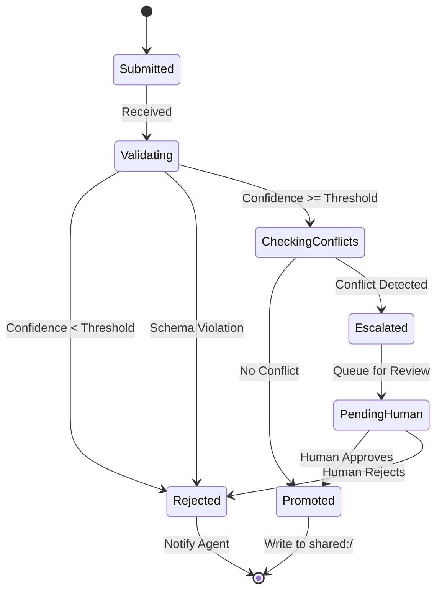
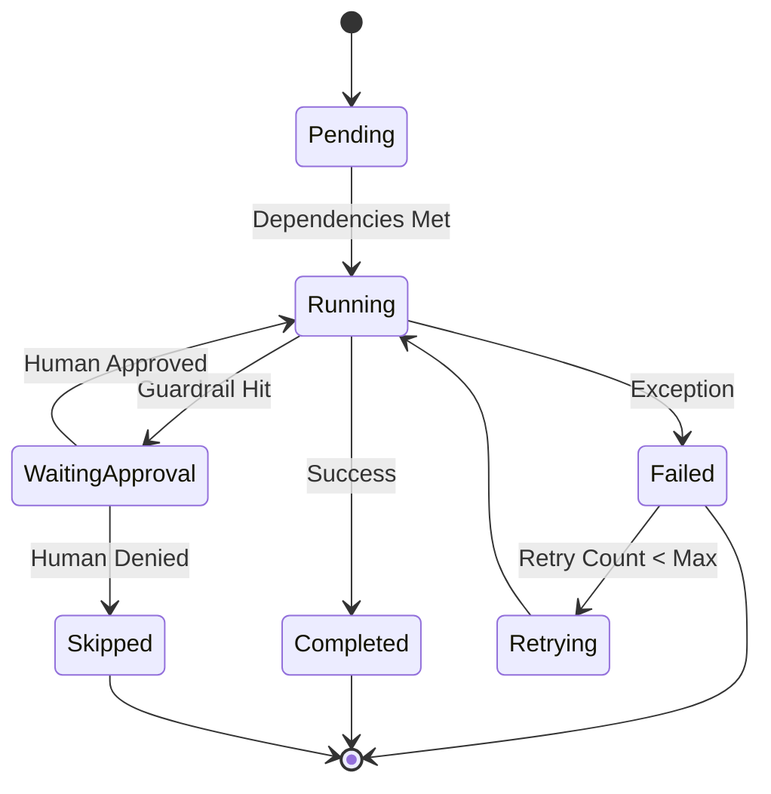

# Friday Agent Framework: Technical Specifications

**Date:** February 10, 2026
**Status:** Engineering Specification
**Reference:** `comprehensive-agent-framework-design.md`
**Scope:** Strict implementation details for `packages/friday-agent`, `packages/friday-core`, and `packages/friday-runtime`.

---

## 1. Interface Contracts (ABCs)

These interfaces define the mandatory behavior for the core system components. All implementations must adhere strictly to these signatures.

### 1.1 The Friday Kernel (`SystemRuntime`)
The entry point for the "Headless" runtime. This interface decouples the CLI from the internal logic.

```python
from abc import ABC, abstractmethod
from typing import AsyncGenerator
from uuid import UUID

class SystemRuntime(ABC):
    """
    The Operating System for the Friday Hive.
    Handles component lifecycle, session management, and global policy.
    """

    @abstractmethod
    async def start(self) -> None:
        """Bootstraps singleton services (Memory, Workspace, Telemetry)."""
        pass

    @abstractmethod
    async def stop(self) -> None:
        """Graceful shutdown. Flushes logs, persists memory, stops agents."""
        pass

    @abstractmethod
    async def create_session(self, user_id: str, metadata: dict = None) -> str:
        """
        Creates a new session context.
        Returns: session_id (UUID string)
        """
        pass

    @abstractmethod
    async def execute_workflow(
        self, 
        session_id: str, 
        workflow_name: str, 
        inputs: dict
    ) -> AsyncGenerator["RuntimeEvent", None]:
        """
        Executes a named workflow or agent task.
        Yields structured events (Tokens, Status, Artifacts) for the client.
        """
        pass

    @abstractmethod
    async def spawn_agent(self, agent_name: str, session_id: str) -> "AgentHandle":
        """
        Instantiates an agent within a specific session scope.
        Enforces namespace isolation policies.
        """
        pass
```

### 1.2 The Agent Core (`AgentInterface`)
The contract for the atomic unit of execution (the "Body").

```python
from typing import Literal, Any

class AgentInterface(ABC):
    """
    The Body responsible for executing tasks.
    """

    @abstractmethod
    async def initialize_session(self, session_id: str, user_id: str) -> None:
        """Binds the agent to a specific session context."""
        pass

    @abstractmethod
    async def run(self, input_signal: str | dict) -> str | "FridayArtifact":
        """
        The main execution loop (Think -> Act -> Respond).
        Returns text or a typed Artifact.
        """
        pass

    @abstractmethod
    def set_autonomy_policy(self, policy: Literal["manual", "auto", "hybrid"]) -> None:
        """
        Configures tool selection strategy.
        - Manual: Use tools injected by Orchestrator.
        - Auto: Agent selects its own tools.
        - Hybrid: Agent starts with Manual, can request more.
        """
        pass
        
    @abstractmethod
    def emit_telemetry(self, event_type: str, payload: dict) -> None:
        """
        Emits structured trace data (Thought, Action, Result) to the Kernel.
        """
        pass
```

### 1.3 The Registry (`RegistryInterface`)
The contract for the "Talent Pool".

```python
class RegistryInterface(ABC):
    """
    Directory service for Agent Capabilities.
    """

    @abstractmethod
    def register_profile(self, profile: "AgentProfile") -> None:
        """Manually register an agent definition."""
        pass

    @abstractmethod
    def load_manifests(self, directory_path: str) -> int:
        """Bulk load agent YAMLs from disk. Returns count loaded."""
        pass

    @abstractmethod
    def find_agents(self, capability: str) -> list["AgentProfile"]:
        """Find agents by capability tag (e.g. 'web-search')."""
        pass

    @abstractmethod
    def create_agent(self, name: str, runtime_deps: dict) -> "AgentInterface":
        """
        Factory method to instantiate an agent with injected dependencies.
        """
        pass
```

### 1.4 The Orchestrator (`OrchestratorInterface`)
The contract for the "Nervous System".

```python
class OrchestratorInterface(ABC):
    """
    Manages control flow and routing.
    """

    @abstractmethod
    async def route(self, input_text: str, session_id: str) -> "AgentInterface":
        """
        Determines the target agent based on explicit (@name) or semantic routing.
        Validates that the session_id is active.
        """
        pass

    @abstractmethod
    async def delegate(self, from_agent: str, to_agent: str, task: str) -> str:
        """
        Handles sub-task delegation, preserving session context.
        """
        pass
```

### 1.5 The Arbitrator (`ArbitrationInterface`)
The contract for the "Conscience" (Truth Maintenance).

```python
class ArbitrationInterface(ABC):
    """
    Gateway for Shared Memory operations.
    """

    @abstractmethod
    async def submit_proposal(self, proposal: "MemoryProposal") -> "ArbitrationResult":
        """
        Submit a fact for promotion to Shared Memory.
        Returns immediately (if rules-based) or a Ticket ID (if async/human).
        """
        pass

    @abstractmethod
    async def get_decision(self, ticket_id: str) -> "ArbitrationResult":
        """Poll for the result of an async arbitration."""
        pass

    @abstractmethod
    async def resolve_conflict(self, conflict_id: str) -> None:
        """Force a resolution (used by Human-in-the-Loop)."""
        pass
```

### 1.6 The Workspace (`ArtifactWorkspaceInterface`)
The contract for the "Shared Table".

```python
class ArtifactWorkspaceInterface(ABC):
    """
    Manages the lifecycle and storage of Artifacts.
    """

    @abstractmethod
    async def store(
        self, 
        content: bytes, 
        mime_type: str, 
        metadata: dict,
        lifecycle: Literal["ephemeral", "durable"]
    ) -> "FridayArtifact":
        """Persist content and return the Artifact envelope."""
        pass

    @abstractmethod
    async def retrieve(self, artifact_id: UUID) -> bytes:
        """Retrieve raw content by ID."""
        pass

    @abstractmethod
    async def resolve_smart_reference(self, artifact_id: UUID, max_tokens: int) -> str:
        """
        Intelligently resolve an artifact for LLM context.
        Returns: Full content, Snippet, or Summary based on token budget.
        """
        pass
```

### 1.7 The Friday Lab (`LabHarnessInterface`)
The contract for the "Testing Environment".

```python
class LabHarnessInterface(ABC):
    """
    Integration environment for stress-testing the Hive.
    """

    @abstractmethod
    async def inject_conflict(self, fact_a: "MemoryProposal", fact_b: "MemoryProposal") -> None:
        """Simulate a race condition or semantic conflict."""
        pass

    @abstractmethod
    async def replay_session(self, session_log_path: str) -> None:
        """Deterministically replay a recorded session."""
        pass

    @abstractmethod
    def mock_agent(self, name: str, fixed_responses: list[str]) -> None:
        """Replace a real LLM agent with a deterministic mock."""
        pass
```

---

## 2. Data Schemas (Pydantic Models)

These models define the "Wire Format" for communication between components.

### 2.1 Artifact Protocol

```python
from pydantic import BaseModel, Field
from typing import Literal, Dict
from datetime import datetime
from uuid import UUID

class FridayArtifact(BaseModel):
    """
    A typed unit of content produced by an agent.
    """
    id: UUID
    type: str = Field(..., description="MIME type (e.g. application/x-python-code)")
    reference: str = Field(..., description="URI (e.g. workspace://session_123/file_abc)")
    
    metadata: Dict[str, str] = Field(
        default_factory=dict, 
        description="Keys: creator_id, version, filename, language"
    )
    
    lifecycle: Literal["ephemeral", "durable", "archived"] = "ephemeral"
    created_at: datetime = Field(default_factory=datetime.utcnow)
```

### 2.2 Memory Proposal (Arbitration)

```python
class MemoryProposal(BaseModel):
    """
    A request to promote a fact to Shared Memory.
    """
    id: UUID
    source_agent_id: str  # Format: "name-uuid"
    session_id: str
    
    # The Fact
    entity_name: str
    attribute: str
    value: str | FridayArtifact
    
    # Validation
    confidence: float = Field(..., ge=0.0, le=1.0)
    evidence: str = Field(..., description="Reasoning or Source URI")
    
    scope: Literal["private", "shared"]
```

### 2.3 Runtime Events (Client Protocol)

```python
class RuntimeEvent(BaseModel):
    """
    Events streamed from Kernel to Client (CLI/UI).
    """
    type: Literal["token", "log", "artifact", "status", "error", "interrupt"]
    payload: dict
    timestamp: datetime
```

---

## 3. State Machines

### 3.1 Arbitrator Decision Lifecycle



### 3.2 Workflow Task Lifecycle



---

## 4. Error Handling Strategy

### 4.1 Global Circuit Breakers
The Kernel must implement circuit breakers for external services.

*   **Memory System:** If `MemoryController` times out (e.g., >5s), the Kernel switches to `DegradedMode` (Episodic Only) and logs a Critical Alert.
*   **LLM Provider:** If the LLM API returns 5xx errors, the Kernel retries with Exponential Backoff (1s, 2s, 4s, 8s). If failure persists, the Workflow pauses and emits an `Interrupt` event.

### 4.2 Arbitration Failures
*   **Arbitrator Down:** If the Arbitrator agent fails to instantiate, all `shared:/` writes are **Blocked**. Agents default to `private` scope and log a warning. The system does not crash, but "Truth Convergence" pauses.
*   **Deadlock:** If an arbitration ticket is stuck in `Escalated` for >24 hours, it is auto-rejected to clear the queue.

### 4.3 Agent Panics
*   **Tool Errors:** If a tool raises an unhandled exception, the Agent catches it, logs it to `telemetry`, and receives a formatted error string ("Tool X failed: [Error]"). It is expected to self-correct.
*   **Crash Loop:** If an agent crashes 3 times in 1 minute, the Orchestrator permanently disables that agent instance and fails the workflow.

---

## 5. Namespace Specifications

### 5.1 Format
*   **Pattern:** `^(?P<agent_name>[a-z][a-z0-9_]*)-(?P<short_uuid>[a-f0-9]{8}):\/`
*   **Example:** `researcher-a1b2c3d4:/`
*   **Validation:** Regex match required for all Memory operations.

### 5.2 Scope Rules
*   **Private Write:** Allowed only if `caller.id == namespace.owner`.
*   **Private Read:** Allowed if `caller.id == namespace.owner` OR `caller.id` is in `namespace.allow_read` list.
*   **Shared Write:** **FORBIDDEN** for all agents. Only `Arbitrator` identity can write.
*   **Shared Read:** Allowed for all.
